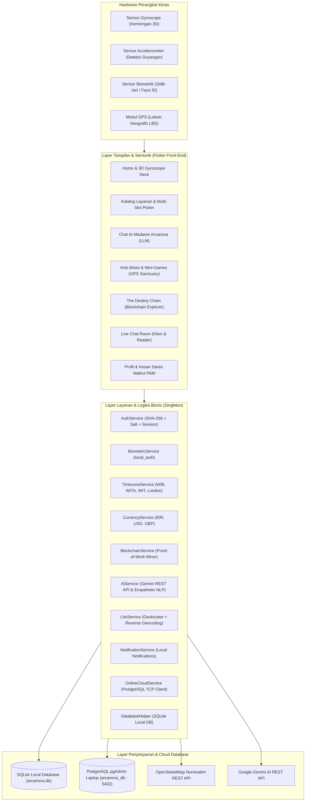
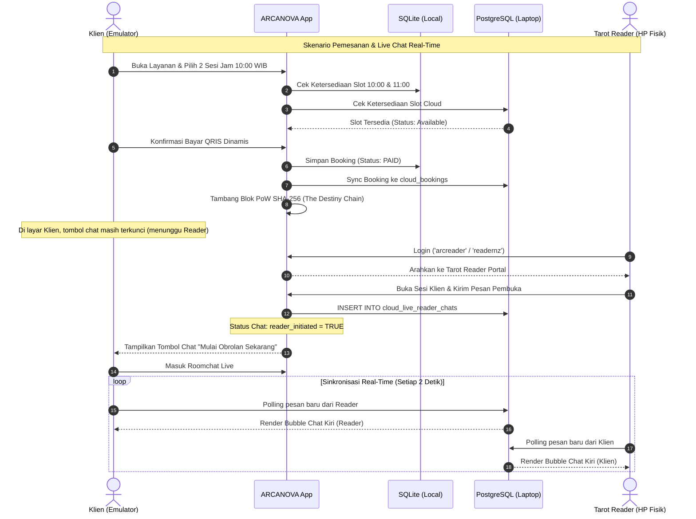

# DOKUMEN SPESIFIKASI SISTEM, USER FLOW, DAN BEDAH KODE LENGKAP APLIKASI ARCANOVA
**Mata Kuliah:** Pemrograman Aplikasi Mobile (PAM)  
**Platform:** Flutter (Android & iOS Multiplatform)  
**Basis Data:** SQLite (Lokal) & PostgreSQL pgAdmin (Online Cloud)  
**Arsitektur Desain:** Cyber-Mystic Sacred Spiritual UI / Hybrid Client-Server  

---

## DAFTAR ISI
1. **BAB I: DESKRIPSI SISTEM & ARSITEKTUR TEKNOLOGI**
   - 1.1 Visi dan Konsep Spiritual Cyber-Mystic
   - 1.2 Arsitektur Sistem Hybrid & Dual-Database
   - 1.3 Diagram Arsitektur Aplikasi (Mermaid)
2. **BAB II: ALUR SISTEM & USER FLOW LENGKAP**
   - 2.1 Alur Klien / Pengguna Biasa (*End-to-End User Flow*)
   - 2.2 Alur Tarot Reader / Konsultan Spiritual (*Reader Portal Flow*)
   - 2.3 Diagram Alur Interaksi Klien & Reader (Mermaid Sequence)
3. **BAB III: MATRIKS EVALUASI PEMENUHAN 12 KRITERIA TUGAS BESAR PAM**
4. **BAB IV: BEDAH ANATOMI & FUNGSI SELURUH FILE (SEMUA 35 FILE)**
   - 4.1 Root & Core Configuration (`lib/main.dart`)
   - 4.2 Constants & Design Tokens (`lib/constants/` - 3 file)
   - 4.3 Data Models (`lib/models/` - 5 file)
   - 4.4 Services & Business Logic (`lib/services/` - 11 file)
   - 4.5 Views & User Interface Screens (`lib/views/` - 15 file)
5. **BAB V: BEDAH POTONGAN KODE FITUR UTAMA (LOGIC & TAMPILAN)**
   - 5.1 Autentikasi Enkripsi SHA-256 + Salt & Inactivity Session Timer
   - 5.2 Autentikasi Sensor Biometrik Sidik Jari (`local_auth`)
   - 5.3 Dual Database: SQLite Lokal & PostgreSQL Cloud (pgAdmin Laptop)
   - 5.4 Web Service REST API, Gemini LLM, & Location-Based Service (LBS)
   - 5.5 Multi-Currency Converter & 4 Zona Waktu Global
   - 5.6 Hardware Sensors: Gyroscope 3D Parallax Tilt & Accelerometer
   - 5.7 Kecerdasan Buatan (AI) & LLM Empatis: Madame Arcanova
   - 5.8 Mini-Games Tematik: Cosmic Love Match & GPS Sanctuary
   - 5.9 Fasilitas Pencarian Tarot & Multi-Session Slot Auto-Blocking
   - 5.10 Notifikasi Mobile Lokal Terjadwal
   - 5.11 Blockchain Sederhana: The Destiny Chain & Proof-of-Work Mining
   - 5.12 Real-Time Live Chat Reader Engine (Multi-Device Sync)
6. **BAB VI: PANDUAN PENGUJIAN & DEMONSTRASI SIDANG/PRESENTASI**

---

# BAB I: DESKRIPSI SISTEM & ARSITEKTUR TEKNOLOGI

### 1.1 Visi dan Konsep Spiritual Cyber-Mystic
**ARCANOVA** adalah aplikasi mobile konsultasi tarot, astrologi, dan pembacaan energi spiritual modern yang memadukan nuansa mistis klasik (*Sacred Esoteric Tarot*) dengan kecanggihan teknologi komputasi modern (*Cyber-Mystic Technology*).

Aplikasi ini dibangun untuk mengatasi kendala konvensional dalam industri ramalan spiritual:
1. **Privasi & Keamanan Rendah:** ARCANOVA melindungi kredensial pengguna menggunakan hashing kriptografis SHA-256 + Salt acak serta sensor biometrik lokal tanpa ketergantungan pada pihak ketiga seperti Firebase.
2. **Keterbatasan Jarak & Waktu:** Mengintegrasikan konversi multi-zona waktu otomatis (WIB, WITA, WIT, London GMT) dan multi-mata uang dinamis (IDR, USD, GBP) sehingga konsultasi antar-benua dapat dilakukan dengan presisi harga dan jadwal.
3. **Redundansi Jadwal Konsultasi:** Sistem reservasi cerdas memblokir slot konsultasi berturut-turut (*multi-session auto-blocking*) secara instan di SQLite lokal dan tersinkronisasi ke PostgreSQL cloud sehingga tidak ada dua pengguna yang memesan jam yang sama.
4. **Keaslian & Bukti Hasil Pembacaan:** Dilengkapi teknologi *Blockchain In-App (The Destiny Chain)* yang menyegel setiap sesi konsultasi ke dalam blok digital terdesentralisasi menggunakan algoritma konsensus *Proof-of-Work (PoW)* dan hash kriptografis yang *immutable* (tidak dapat dipalsukan).
5. **Real-Time Cross-Device Communication:** Mengizinkan interaksi obrolan dua arah langsung (*live chat*) antara emulator (klien) dan smartphone fisik (tarot reader) secara tersinkronisasi melalui database online PostgreSQL di laptop lokal (`pgAdmin`).

### 1.2 Arsitektur Sistem Hybrid & Dual-Database
Aplikasi menggunakan pola arsitektur **Hybrid Client-Server dengan Dual-Layer Storage**:
- **Layer Presentasi (UI/UX):** Menggunakan framework Flutter dengan palet warna *Cyber-Mystic* (Void Black `#07060F`, Neon Purple `#A855F7`, Celestial Cyan `#22D3EE`, Shimmer Silver `#E2E8F0`). Interaksi diperkaya efek 3D Parallax berbasis data real-time sensor Gyroscope.
- **Layer Logika Bisnis (Services):** Terdiri dari 11 modul *service* modular yang menerapkan prinsip *Singleton Design Pattern* untuk efisiensi alokasi memori.
- **Layer Penyimpanan Data (Persistence):**
  - **Penyimpanan Lokal:** SQLite (`sqflite`) menyimpan data akun, sesi login aktif, cache 22 kartu tarot Major Arcana, bookmark, ulasan mata kuliah PAM, dan salinan lokal rantai blok blockchain.
  - **Penyimpanan Online Cloud:** Database PostgreSQL (`arcanova_db`) pada laptop pengembang (`pgAdmin`) terhubung melalui koneksi TCP socket murni (`postgres` Dart package) melalui port `5432`. Emulator terhubung via IP `10.0.2.2`, sedangkan HP fisik terhubung via `127.0.0.1` menggunakan port forwarding `adb reverse tcp:5432 tcp:5432`.
  - **REST API Eksternal:** Mengintegrasikan OpenStreetMap Nominatim API (LBS geocoding koordinat GPS ke nama kota/provinsi), Google Gemini AI API (pemrosesan bahasa alami Generative LLM), serta JSONPlaceholder & HttpBin (cloud fallback ulasan & blok).

### 1.3 Diagram Arsitektur Aplikasi


---

# BAB II: ALUR SISTEM & USER FLOW LENGKAP

### 2.1 Alur Klien / Pengguna Biasa (*End-to-End User Flow*)
```
[Buka Aplikasi]
       │
       ▼
[Layar Login] ──(Belum Punya Akun)──► [Layar Registrasi]
       │                                     │
       │ (Input Username, Sandi, Gender:     │ (Validasi & Hash SHA-256)
       │  👨 Pria / 👩 Wanita, Zodiak)        │
       │                                     ▼
       ├────────────────────────────── [Simpan ke SQLite]
       │
       ├──(Opsi 1: Login Form Manual)──────► Verifikasi SHA-256 + Salt
       └──(Opsi 2: Login Cepat Biometrik)──► Sensor Sidik Jari (local_auth)
       │
       ▼ (Login Berhasil, Role: 'user')
[Menu Utama: Bottom Navigation 5 Tab]
       │
       ├── Tab 1: [BERANDA (Home)]
       │     • Interaksi 3D Parallax Deck (Sensor Gyroscope memiringkan kartu saat HP dimiringkan)
       │     • Kocok Dek Harian (Sensor Accelerometer / Tombol) -> Tarik Kartu Hari Ini
       │     • Pencarian Kartu Tarot (Filter teks nama kartu) & Pemilihan 4 Elemen (Api, Air, Udara, Tanah)
       │
       ├── Tab 2: [LAYANAN (Services)]
       │     • Pilih Katalog: Tarot Asmara, Karir & Finansial, Aura Chakra, Konsultasi Lengkap
       │     • Konversi Mata Uang Terintegrasi: Pilih IDR, USD, atau GBP (Harga otomatis dikonversi)
       │     • Pemilihan Tanggal Konsultasi & Jumlah Sesi (1, 2, atau 3 Sesi berturut-turut)
       │     • Pemilihan Slot Jam: Sistem otomatis mengecek jam yang bentrok di SQLite & PostgreSQL.
       │       Slot yang sudah dipesan otomatis diblokir bertanda [PENUH / BOOKED].
       │     • Konversi Waktu Terpilih: Menampilkan padanan jam di WIB, WITA, WIT, dan London GMT.
       │     • Lanjut ke Pembayaran -> QRIS Dinamis & Simulasi Bayar -> Blok Blockchain Otomatis Ditambang!
       │     • Floating Action Button (FAB) Chat: Otomatis AKTIF HANYA jika sesi sudah dipesan DAN Reader telah memulai chat!
       │
       ├── Tab 3: [HUB MISTIS (Games & LBS)]
       │     • Mini-Game 1: Cosmic Love Match (Kalkulator kompatibilitas zodiak dengan visualisasi gender)
       │     • Mini-Game 2: Sanctuary GPS Quest (LBS melacak koordinat GPS user & reverse geocoding via OpenStreetMap API)
       │
       ├── Tab 4: [CHAT AI (Madame Arcanova)]
       │     • Konsultasi ramalan berbasis AI LLM (Gemini REST API) dengan gaya bahasa hangat, empatik, layaknya teman curhat.
       │     • Dilengkapi Life-Scope Filter: Hanya merespons topik tarot, asmara, karir, dan pengembangan diri.
       │
       └── Tab 5: [PROFIL & PENGATURAN]
             • Kartu Profil dengan Foto Avatar Gender (👨 / 👩) dan Tanggal Lahir
             • Riwayat Pemesanan (The Destiny Chain): Visualisasi rantai blok vertikal bersinar, badge "🔒 Terverifikasi Blockchain", rincian nomor blok, hash SHA-256, dan tombol salin kunci validasi.
             • Ledger Kriptografi: Menu menambang blok afirmasi baru (PoW) dan verifikasi integritas rantai.
             • Form Saran & Kesan Kuliah PAM: Rating bintang 1-5, input teks kesan/saran, tersimpan di SQLite & PostgreSQL.
             • Fitur Logout & Hapus Akun Permanen.

[Fitur Keamanan Pasif: Inactivity Session Auto-Logout]
Jika aplikasi ditinggal di latar belakang (background / minimize) selama >= 5 menit (300 detik), aplikasi otomatis me-reset session aktif dan mengembalikan pengguna ke Mode Tamu untuk mencegah penyalahgunaan.
```

### 2.2 Alur Tarot Reader / Konsultan Spiritual (`arcreader`)
```
[Layar Login Terpadu]
       │
       ▼
Input Kredensial Khusus Konsultan:
• Username: 'arcreader'
• Password: 'readernz'
       │
       ▼ (Sistem membaca role di SQLite: 'tarot_reader')
[Redirect Otomatis ke TAROT READER PORTAL]
(Tidak masuk ke dashboard user biasa)
       │
       ▼
[Reader Portal Dashboard]
       │
       ├── Statistik Praktisi:
       │     • Status: "Online & Siap Membimbing"
       │     • Total Klien Sesi Aktif
       │     • Jadwal Jam Kerja Konsultasi (09:00 - 18:00 WIB)
       │
       ├── Daftar Sesi Klien Terjadwal:
       │     • Membaca data booking aktif dari SQLite dan PostgreSQL laptop
       │     • Menampilkan nama klien, tanggal sesi, jam WIB & jam London, jumlah sesi, dan total bayar
       │
       ├── Aksi Inisiasi Ruang Obrolan:
       │     • Reader menekan tombol: "Buka Ruang Konsultasi (WA-Style)"
       │     • Reader mengetik sapaan pembuka pertama: "Halo, saya Master Alistair siap membaca energi Anda."
       │     • Pesan tersimpan di database PostgreSQL laptop (`cloud_live_reader_chats`)
       │     • SISTEM MEMICU AKTIVASI: Klien sekarang dapat melihat dan membuka tombol chat di layarnya!
       │
       ├── Sesi Konsultasi Live Dua Arah (Real-Time Polling):
       │     • Menggunakan antarmuka WhatsApp-style (header hijau mistis, bubble kiri/kanan dinamis)
       │     • Interval polling 2 detik memastikan pesan terkirim & diterima seketika antara HP Reader & HP Klien
       │
       └── Pembersihan Arsip Sesi Otomatis (H+3):
             • Tombol "Hapus Riwayat (>3 Hari)" untuk membersihkan sesi kedaluwarsa sesuai regulasi privasi.
```

### 2.3 Diagram Alur Interaksi Klien & Reader


---

# BAB III: MATRIKS EVALUASI PEMENUHAN 12 KRITERIA TUGAS BESAR PAM

Berikut adalah tabel pemetaan 12 kriteria tugas pemrograman mobile yang diwajibkan dosen beserta rincian implementasi, file pendukung, dan bukti teknisnya dalam kode:

| No | Kriteria Tugas Dosen | Implementasi Nyata di Aplikasi ARCANOVA | File Implementasi | Bukti Teknis Kode / Algoritma |
|:--:|:---|:---|:---|:---|
| **1** | **Login dengan enkripsi (tanpa Firebase) & Session** | Autentikasi akun lokal mandiri. Kata sandi dienkripsi dengan SHA-256 + cryptographic Salt. Session disimpan di memori & SQLite. Auto-logout otomatis jika di-minimize >= 5 menit. | `lib/services/auth_service.dart`<br>`lib/views/auth/login_screen.dart`<br>`lib/views/main_navigation.dart` | `sha256.convert(utf8.encode(password + salt))`<br>`WidgetsBindingObserver.didChangeAppLifecycleState` (300s timeout) |
| **2** | **Login Biometric** | Autentikasi biometrik sidik jari (*fingerprint*) / Face ID menggunakan pustaka native `local_auth`. Dilengkapi tombol pintas di layar login dan toggle di profil. | `lib/services/biometric_service.dart`<br>`lib/views/auth/biometric_scan_screen.dart` | `LocalAuthentication.authenticate(localizedReason: ...)` |
| **3** | **Koneksi Database Lokal & Online** | **Dual Database:**<br>1. **Lokal:** SQLite (`sqflite`) untuk pengguna, booking, chat, dan blok.<br>2. **Online Cloud:** PostgreSQL di laptop pengembang (`pgAdmin`) port 5432 untuk sinkronisasi live chat, cloud booking, dan evaluasi kuliah. | `lib/services/db_helper.dart`<br>`lib/services/online_cloud_service.dart` | SQLite: `openDatabase('arcanova.db')`<br>PostgreSQL: `Connection.open(Endpoint(host: '10.0.2.2' / '127.0.0.1', port: 5432, database: 'arcanova_db'))` |
| **4** | **Web Service / API, IoT/Multiplatform & LBS** | 1. **LBS:** Geolocator GPS + reverse geocoding via OpenStreetMap Nominatim REST API.<br>2. **Multiplatform:** Android & iOS ready.<br>3. **REST API Cloud:** Gemini AI REST API, JSONPlaceholder, & HttpBin. | `lib/services/lbs_service.dart`<br>`lib/services/ai_service.dart`<br>`lib/services/online_cloud_service.dart` | `http.get('https://nominatim.openstreetmap.org/reverse?lat=...&lon=...')`<br>`Geolocator.getCurrentPosition()` |
| **5** | **Bottom Navigation, Profil (Ada Gambar), Saran & Kesan PAM, Logout** | Bottom Navigation 5 tab bersih. Profil menampilkan foto avatar dinamis (👨 Pria / 👩 Wanita). Menu Saran & Kesan Matkul PAM (bintang 1-5 & ulasan teks). Tombol logout dengan konfirmasi dialog. | `lib/views/main_navigation.dart`<br>`lib/views/profile/profile_screen.dart`<br>`lib/views/feedback/course_feedback_screen.dart` | `BottomNavigationBar` (5 item)<br>Form rating bintang + sync SQLite & PostgreSQL<br>`AuthService.instance.logout()` |
| **6** | **Konversi Mata Uang (min. 3) & Zona Waktu (WIB, WIT, WITA, London)** | 1. **Mata Uang:** IDR (Rp), USD ($), dan GBP (£) dengan kurs real-time spiritual.<br>2. **Zona Waktu:** Konversi otomatis jam sesi ke 4 zona: WIB (UTC+7), WITA (UTC+8), WIT (UTC+9), dan London GMT (UTC+0/1). | `lib/services/currency_service.dart`<br>`lib/services/timezone_service.dart`<br>`lib/views/booking/services_screen.dart` | `CurrencyService.convert(priceIdr, 'USD')`<br>`TimezoneService.getAllZoneTimes('14:00')` -> WIB, WITA, WIT, London |
| **7** | **Minimal 2 Sensor Perangkat Keras Sesuai Konsep** | 1. **Sensor Gyroscope:** Menggerakkan kartu tarot 3D secara dinamis (*parallax tilt*) saat ponsel dimiringkan.<br>2. **Sensor Accelerometer:** Mendeteksi goyangan fisik ponsel (*shake to draw*) untuk menarik kartu harian.<br>3. **Sensor GPS:** Pelacak lokasi suci (*Sanctuary Quest*). | `lib/services/sensor_service.dart`<br>`lib/views/home/home_screen.dart`<br>`lib/views/games/mystic_hub_screen.dart` | `gyroscopeEventStream()`<br>`userAccelerometerEventStream()`<br>`Transform3D (rotateX, rotateY)` |
| **8** | **Fitur AI & Large Language Model (LLM)** | Madame Arcanova: Asisten tarot cerdas terintegrasi Google Gemini Generative AI REST API + NLP engine lokal berbahasa santai hangat seperti teman curhat, dilengkapi filter ranah spiritual/kehidupan. | `lib/services/ai_service.dart`<br>`lib/views/ai_chat/ai_chat_screen.dart` | `GenerativeModel(model: 'gemini-1.5-flash')`<br>`generateContent(prompt)` |
| **9** | **Fitur Mini Games Sederhana Sesuai Konsep** | 1. **Cosmic Love Match:** Mini-game kalkulator kecocokan zodiak dengan visualisasi outline gender pengguna.<br>2. **Sanctuary GPS Explorer:** Mini-game penemuan tempat suci terdekat berbasis jarak meter GPS. | `lib/views/games/mystic_hub_screen.dart` | Algoritma kalkulasi keselarasan zodiak elemen + geofencing jarak haversine formula |
| **10** | **Fasilitas Pencarian & Pemilihan** | 1. **Pencarian Tarot:** Fitur cari kartu berdasarkan nama secara instan.<br>2. **Pemilihan Elemen:** Filter 4 elemen semesta.<br>3. **Pemilihan Sesi & Jam:** Slot picker interaktif dengan proteksi bentrok. | `lib/views/home/home_screen.dart`<br>`lib/views/booking/services_screen.dart` | `List.where((card) => card.name.toLowerCase().contains(query))`<br>`FilterChip(Fire, Water, Air, Earth)` |
| **11** | **Fitur Notifikasi Berbasis Mobile** | Notifikasi push lokal terjadwal (*local notifications*) menggunakan `flutter_local_notifications` untuk mengingatkan pengguna 5-10 menit sebelum sesi konsultasi tarot dimulai. | `lib/services/notification_service.dart` | `FlutterLocalNotificationsPlugin.zonedSchedule(...)` |
| **12** | **Fitur Blockchain Sederhana** | **The Destiny Chain:** Sistem buku besar terdistribusi dengan algoritma *Proof-of-Work (PoW)*, hashing SHA-256 berantai (*previous hash*), pembuatan Genesis Block, dan kunci validasi transaksi. | `lib/models/blockchain_block.dart`<br>`lib/services/blockchain_service.dart`<br>`lib/views/booking/order_history_screen.dart` | `BlockchainBlock.mineBlock(difficulty: 2)`<br>`verifyChainIntegrity()` |

---

# BAB IV: BEDAH ANATOMI & FUNGSI SELURUH FILE (SEMUA 35 FILE)

Berikut adalah ulasan mendalam mengenai seluruh 35 berkas kode yang ada di direktori `lib/` tanpa ada yang terlewat:

```
lib/
├── main.dart                                [Entry Point & Initializer Aplikasi]
├── constants/
│   ├── app_colors.dart                      [Definisi Palet Warna Cyber-Mystic]
│   ├── app_theme.dart                       [Definisi Typography & ThemeData]
│   └── tarot_data.dart                      [Basis Data 22 Kartu Major Arcana]
├── models/
│   ├── blockchain_block.dart                [Model Struktur Data Blok Kriptografi]
│   ├── booking_model.dart                   [Model Data Pemesanan Layanan]
│   ├── feedback_model.dart                  [Model Data Masukan & Saran Matkul PAM]
│   ├── tarot_card.dart                      [Model Objek Kartu Tarot]
│   └── user_model.dart                      [Model Objek Akun Pengguna]
├── services/
│   ├── ai_service.dart                      [Engine LLM AI Chat Madame Arcanova]
│   ├── auth_service.dart                    [Enkripsi SHA-256, Register & Session]
│   ├── biometric_service.dart               [Sensor Biometrik Sidik Jari]
│   ├── blockchain_service.dart              [Algoritma Proof-of-Work & Miner]
│   ├── currency_service.dart                [Konverter Multi-Mata Uang IDR/USD/GBP]
│   ├── db_helper.dart                       [Database Helper SQLite Lokal]
│   ├── lbs_service.dart                     [Location-Based Service & Reverse Geocoding]
│   ├── notification_service.dart            [Pengelola Notifikasi Mobile Lokal]
│   ├── online_cloud_service.dart            [Konektor PostgreSQL Laptop & Cloud API]
│   ├── sensor_service.dart                  [Sensor Gyroscope & Accelerometer]
│   └── timezone_service.dart                [Kalkulator 4 Zona Waktu & Slot Sesi]
└── views/
    ├── main_navigation.dart                 [Bottom Navbar 5 Tab & Session Inactivity]
    ├── ai_chat/
    │   └── ai_chat_screen.dart              [UI Chat Interaktif AI Curhat]
    ├── auth/
    │   ├── biometric_scan_screen.dart       [UI Sensor Pemindai Sidik Jari]
    │   ├── login_screen.dart                [UI Login Terpadu (User & Reader)]
    │   └── register_screen.dart             [UI Registrasi Akun & Gender Avatar]
    ├── booking/
    │   ├── order_history_screen.dart        [UI The Destiny Chain (Rantai Blok)]
    │   ├── payment_screen.dart              [UI Pembayaran QRIS Dinamis]
    │   ├── services_screen.dart             [UI Katalog, Multi-Slot & Dynamic Chat FAB]
    │   └── session_waiting_screen.dart      [UI Hitung Mundur Sesi Konsultasi]
    ├── feedback/
    │   └── course_feedback_screen.dart      [UI Form Saran & Kesan Matkul PAM]
    ├── games/
    │   └── mystic_hub_screen.dart           [UI Mini-Games Love Match & LBS Quest]
    ├── home/
    │   └── home_screen.dart                 [UI Beranda, 3D Gyro Deck & Search Filter]
    ├── live_chat/
    │   └── reader_chat_screen.dart          [UI Live Chat Real-Time WhatsApp Style]
    ├── profile/
    │   └── profile_screen.dart              [UI Profil, Avatar, Ledger & Settings]
    └── reader_portal/
        └── reader_portal_screen.dart        [UI Dashboard Khusus Tarot Reader POV]
```

### 4.1 Root & Core Configuration
#### 1. `lib/main.dart`
- **Fungsi Utama:** Titik masuk utama aplikasi (*entry point*).
- **Peran:** Inisialisasi binding Flutter, penguncian orientasi layar ke mode potret (*portrait-up*), inisialisasi modul notifikasi lokal, inisialisasi database lokal SQLite, dan penataan tema global gelap (*Dark Mystic Theme*).
- **Komponen Inti:**
  - `WidgetsFlutterBinding.ensureInitialized()`: Memastikan subsistem engine Flutter siap sebelum mengeksekusi plugin native.
  - `NotificationService.instance.init()`: Meminta izin notifikasi Android/iOS dan mendaftarkan channel notifikasi.
  - `DatabaseHelper.instance.database`: Menjamin inisialisasi tabel SQLite berjalan sejak awal peluncuran.
  - `SystemChrome.setPreferredOrientations()`: Mencegah tampilan berantakan akibat rotasi horizontal.

---

### 4.2 Constants & Design Tokens
#### 2. `lib/constants/app_colors.dart`
- **Fungsi Utama:** Menyimpan seluruh konstanta warna dan gradien tema *Cyber-Mystic Sacred Spiritual UI*.
- **Peran:** Menjamin konsistensi visual di seluruh layar.
- **Konstanta Kunci:** `voidBlack` (`#07060F`), `astralIndigo` (`#120E2E`), `neonPurple` (`#A855F7`), `celestialCyan` (`#22D3EE`), `brightLavender` (`#C084FC`), `goldAccent` (`#F59E0B`), `successEmerald` (`#10B981`), `cardSurface` (`#1A1635`).

#### 3. `lib/constants/app_theme.dart`
- **Fungsi Utama:** Konfigurasi `ThemeData` bawaan Flutter untuk tipografi, elemen input form, dan tombol.
- **Peran:** Memberikan dekorasi `InputDecoration` bergaya neon gelap (*glow borders*), warna kursor, tombol `ElevatedButton` dengan sudut membulat 16-24px, dan `AppBarTheme` transparan dengan judul berada di tengah.

#### 4. `lib/constants/tarot_data.dart`
- **Fungsi Utama:** Berisi data statis lengkap mengenai 22 Kartu Tarot Major Arcana (dimulai dari *0 - The Fool* hingga *XXI - The World*).
- **Peran:** Menyediakan nama kartu, nomor kartu, makna tegak (*upright*), makna terbalik (*reversed*), elemen semesta (Fire, Water, Air, Earth), dan deskripsi filosofis kartu yang digunakan di Beranda dan AI Chat.

---

### 4.3 Data Models
#### 5. `lib/models/blockchain_block.dart`
- **Fungsi Utama:** Model representasi satu blok data dalam *The Destiny Chain*.
- **Peran:** Menyimpan atribut indeks blok (`index`), timestamp (`timestamp`), payload transaksi sesi (`sessionData`), hash blok sebelumnya (`previousHash`), nilai pembuktian kerja (`nonce`), dan hash blok saat ini (`hash`).
- **Method Kunci:**
  - `BlockchainBlock.mineBlock()`: Menjalankan kalkulasi *Proof-of-Work* untuk menemukan hash dengan awalan "00".
  - `calculateHash()`: Melakukan kalkulasi hashing SHA-256 terhadap seluruh atribut blok.

#### 6. `lib/models/booking_model.dart`
- **Fungsi Utama:** Model data transaksi reservasi layanan konsultasi tarot.
- **Peran:** Memetakan entitas pemesanan antara aplikasi, SQLite lokal, dan PostgreSQL cloud.
- **Atribut:** `id`, `userId`, `serviceTitle`, `sessionDate`, `sessionTimeWib`, `sessionsCount`, `totalPrice`, `currencyUsed`, `paymentStatus`, `createdAt`.

#### 7. `lib/models/feedback_model.dart`
- **Fungsi Utama:** Model data saran dan kesan untuk mata kuliah Pemrograman Aplikasi Mobile (PAM).
- **Peran:** Menyimpan masukan mahasiswa berupa `studentName`, `nim`, `rating` (1.0 - 5.0 bintang), `kesanText`, `saranText`, dan `createdAt`. Mendukung konversi JSON untuk sinkronisasi ke PostgreSQL dan cloud fallback.

#### 8. `lib/models/tarot_card.dart`
- **Fungsi Utama:** Model objek satu kartu tarot.
- **Peran:** Memuat atribut `id`, `name`, `arcanaType`, `element`, `description`, `uprightMeaning`, `reversedMeaning`, dan `imageAsset`.

#### 9. `lib/models/user_model.dart`
- **Fungsi Utama:** Model akun pengguna dan praktisi tarot.
- **Peran:** Menyimpan data pengguna lokal: `id`, `username`, `email`, `passwordHash`, `salt`, `role` (`'user'` atau `'tarot_reader'`), `avatarGender` (`'male'` atau `'female'`), `birthDate`, `zodiacSign`, `timezonePref`, `currencyPref`, dan `biometricEnabled`. Menyediakan getter `avatarEmoji` (👨 atau 👩).

---

### 4.4 Services & Business Logic
#### 10. `lib/services/ai_service.dart`
- **Fungsi Utama:** Mesin pemrosesan chat kecerdasan buatan (*Madame Arcanova*).
- **Peran:** Menghubungkan aplikasi ke Google Gemini Generative AI REST API via HTTP POST. Menyediakan logika respon hangat lokal (*empathetic fallback*) layaknya sahabat curhat jika koneksi internet terputus, serta menerapkan *filter ranah kehidupan* agar AI tidak menjawab topik di luar tarot, spiritual, cinta, dan karir.

#### 11. `lib/services/auth_service.dart`
- **Fungsi Utama:** Pengelola autentikasi akun, sesi pengguna, dan keamanan kredensial.
- **Peran:** Menerapkan fungsi hashing kriptografis SHA-256 yang digabung dengan Salt acak 16 byte. Mengelola status `currentUser`, menangani pendaftaran akun baru, validasi kredensial login, login biometrik, pembaruan profil pengguna, dan *logout*.

#### 12. `lib/services/biometric_service.dart`
- **Fungsi Utama:** Penghubung modul perangkat keras sensor biometrik perangkat.
- **Peran:** Menggunakan package `local_auth` untuk mendeteksi ketersediaan sensor biometrik (sidik jari / pemindai wajah) dan memicu jendela otentikasi biometrik sistem operasi.

#### 13. `lib/services/blockchain_service.dart`
- **Fungsi Utama:** Engine pengelola buku besar terdistribusi (*Blockchain In-App*).
- **Peran:** Membuat *Genesis Block* pertama saat database diinisiasi, menambang (*mine*) sertifikat sesi ramalan baru ke dalam rantai blok, menyimpan blok baru ke SQLite dan PostgreSQL, serta menyediakan fungsi `verifyChainIntegrity()` untuk menguji apakah ada hash yang rusak atau dimanipulasi.

#### 14. `lib/services/currency_service.dart`
- **Fungsi Utama:** Konversi multi-mata uang dinamis.
- **Peran:** Mendukung konversi tarif layanan antara Rupiah Indonesia (IDR), Dolar Amerika Serikat (USD), dan Poundsterling Inggris (GBP) dengan kalkulasi kurs dan pemformatan simbol mata uang resmi.

#### 15. `lib/services/db_helper.dart`
- **Fungsi Utama:** Pengelola basis data relasional lokal perangkat (*SQLite*).
- **Peran:** Menginisialisasi file basis data `arcanova.db`, membuat tabel `users`, `bookings`, `reader_chat_messages`, `blockchain_blocks`, `tarot_cards`, dan `course_feedback`. Menyediakan fungsi CRUD lengkap, pengecekan bentrok slot jam sesi, dan akun default reader otomatis (`arcreader`).

#### 16. `lib/services/lbs_service.dart`
- **Fungsi Utama:** Pengelola Layanan Berbasis Lokasi (*Location-Based Services*).
- **Peran:** Mengakses koordinat GPS (latitude dan longitude) perangkat via `geolocator`, menghitung jarak *Haversine* ke lokasi tempat suci (*Sanctuary Quest*), dan melakukan *Reverse Geocoding* menggunakan OpenStreetMap Nominatim REST API untuk mendapatkan nama kelurahan, kota, dan provinsi pengguna secara real-time.

#### 17. `lib/services/notification_service.dart`
- **Fungsi Utama:** Pengelola notifikasi mobile push lokal.
- **Peran:** Menggunakan `flutter_local_notifications` untuk menjadwalkan notifikasi pengingat sesi konsultasi (*reminder notification*) yang akan berbunyi di status bar ponsel 5-10 menit sebelum jam konsultasi dimulai.

#### 18. `lib/services/online_cloud_service.dart`
- **Fungsi Utama:** Penghubung database online PostgreSQL pada laptop pengembang (`pgAdmin`) dan REST API Fallback.
- **Peran:** Membuka koneksi TCP langsung ke database `arcanova_db` di laptop (port `5432`). Mampu mendeteksi host `10.0.2.2` (emulator) dan `127.0.0.1` (HP fisik via adb reverse). Mengelola tabel `cloud_course_feedback`, `cloud_blockchain_ledger`, `cloud_bookings`, dan `cloud_live_reader_chats`.

#### 19. `lib/services/sensor_service.dart`
- **Fungsi Utama:** Menangkap aliran data (*streams*) perangkat keras sensor ponsel.
- **Peran:** Menampung `gyroscopeEventStream()` (kecepatan sudut rotasi X, Y, Z untuk parallax 3D kartu tarot) dan `userAccelerometerEventStream()` (percepatan gravitasi untuk deteksi goyangan ponsel / *shake gesture*).

#### 20. `lib/services/timezone_service.dart`
- **Fungsi Utama:** Kalkulator dan konverter multi-zona waktu global.
- **Peran:** Mengonversi jam dasar WIB (UTC+7) ke 3 zona waktu lainnya: WITA (UTC+8), WIT (UTC+9), dan London GMT (UTC+0 / UTC+1). Menyediakan method `getSlotsForSession(startWib, sessionsCount)` untuk menghitung rentang slot jam yang terpakai jika user memesan 1, 2, atau 3 sesi berturut-turut.

---

### 4.5 Views & User Interface Screens
#### 21. `lib/views/main_navigation.dart`
- **Fungsi Utama:** Kerangka utama navigasi bawah (*Bottom Navigation Bar*) dan pengawas siklus hidup aplikasi (*Lifecycle Observer*).
- **Peran:** Menampilkan 5 tab bersih: Beranda, Layanan, Hub Mistis, Chat AI, dan Profil. Mengimplementasikan `WidgetsBindingObserver` untuk mendeteksi durasi aplikasi berada di *background*; jika melebihi 5 menit (300 detik), akun otomatis di-logout ke Mode Tamu untuk alasan keamanan sesi.

#### 22. `lib/views/ai_chat/ai_chat_screen.dart`
- **Fungsi Utama:** Layar antarmuka percakapan interaktif dengan *Madame Arcanova*.
- **Peran:** Menampilkan gelembung chat modern, animasi mengetik (*typing indicator*), tombol saran pertanyaan cepat seputar asmara dan karir, dan integrasi penuh dengan `AiService`.

#### 23. `lib/views/auth/biometric_scan_screen.dart`
- **Fungsi Utama:** Layar visualisasi pemindaian sidik jari.
- **Peran:** Menampilkan animasi ikon sidik jari bercahaya neon cyan dan memanggil `BiometricService` untuk autentikasi cepat pengguna tanpa perlu mengetik kata sandi.

#### 24. `lib/views/auth/login_screen.dart`
- **Fungsi Utama:** Layar masuk terpadu untuk semua peran pengguna.
- **Peran:** Menyediakan input username dan kata sandi, tombol verifikasi login kriptografis, tombol pintas login biometrik, tombol masuk Mode Tamu, serta navigasi menuju pendaftaran akun baru. Jika yang login adalah akun tarot reader (`arcreader`), layar secara cerdas langsung mengalihkannya ke *TarotReaderPortalScreen*.

#### 25. `lib/views/auth/register_screen.dart`
- **Fungsi Utama:** Layar registrasi pembuatan akun baru.
- **Peran:** Mengumpulkan data username, email, kata sandi, tanggal lahir, dan **pemilih gender avatar** (👨 Pria / 👩 Wanita). Mengenkripsi kata sandi via `AuthService` dan menyimpannya ke SQLite lokal.

#### 26. `lib/views/booking/order_history_screen.dart`
- **Fungsi Utama:** Layar riwayat pemesanan berbasis blockchain (*The Destiny Chain*).
- **Peran:** Menampilkan daftar kartu vertikal yang dihubungkan garis rantai bercahaya (*glowing chain line*), label keamanan hijau `🔒 Blockchain Verified`, nomor blok kriptografi (Block #84xxxx), hash ringkas, rincian sesi tarot, dan tombol interaktif untuk menyalin Transaction Hash ke clipboard.

#### 27. `lib/views/booking/payment_screen.dart`
- **Fungsi Utama:** Layar konfirmasi dan pembayaran transaksi konsultasi.
- **Peran:** Menampilkan rincian pesanan, konversi harga sesuai mata uang yang dipilih (IDR/USD/GBP), kode QR QRIS dinamis, hitung mundur pembayaran 15 menit, dan tombol simulasi "Selesaikan Pembayaran" yang langsung memicu penambangan blok baru ke *The Destiny Chain* serta sinkronisasi status ke PostgreSQL cloud.

#### 28. `lib/views/booking/services_screen.dart`
- **Fungsi Utama:** Layar katalog layanan tarot dan sistem reservasi slot waktu.
- **Peran:** Menampilkan katalog spesialisasi tarot, pemilih konversi mata uang, pemilih tanggal konsultasi, tombol jumlah sesi (1, 2, atau 3 sesi), dan kisi slot jam konsultasi. Secara otomatis memblokir jam yang bentrok di database lokal maupun cloud. Memiliki tombol terapung (*Floating Action Button*) chat konsultasi yang **hanya muncul jika sesi sudah dipesan dan Reader telah memulai chat terlebih dahulu**.

#### 29. `lib/views/booking/session_waiting_screen.dart`
- **Fungsi Utama:** Layar ruang tunggu pra-konsultasi.
- **Peran:** Menampilkan hitung mundur waktu hingga jadwal konsultasi tiba, panduan persiapan meditasi dan fokus batin bagi klien, serta status kesiapan Tarot Reader.

#### 30. `lib/views/feedback/course_feedback_screen.dart`
- **Fungsi Utama:** Layar pengisian saran dan kesan mata kuliah Pemrograman Aplikasi Mobile (PAM).
- **Peran:** Memenuhi kriteria wajib tugas besar. Menyediakan form input nama mahasiswa, NIM, widget penilaian bintang 1 hingga 5, kolom teks kesan, dan kolom teks saran. Data disimpan ke SQLite lokal dan disinkronkan secara real-time ke PostgreSQL laptop (`cloud_course_feedback`).

#### 31. `lib/views/games/mystic_hub_screen.dart`
- **Fungsi Utama:** Pusat mini-games tematik dan eksplorasi LBS.
- **Peran:** Menggabungkan dua fitur interaktif:
  1. *Cosmic Love Compatibility:* Menghitung kecocokan dua zodiak berdasarkan elemen astrolgi dengan warna border dinamis sesuai gender avatar pengguna.
  2. *Sanctuary GPS Explorer:* Memanfaatkan sensor GPS dan API OpenStreetMap untuk menampilkan lokasi presisi pengguna dan jarak menuju tempat suci energi tarot terdekat.

#### 32. `lib/views/home/home_screen.dart`
- **Fungsi Utama:** Layar beranda utama aplikasi.
- **Peran:** Menampilkan dek tarot interaktif dengan efek rotasi kemiringan 3D (*Parallax*) yang digerakkan oleh sensor Gyroscope fisik. Menyediakan fitur *Daily Card Draw* dengan sensor goyangan ponsel (Accelerometer), kolom pencarian kartu tarot berdasarkan nama, dan chip filter 4 elemen semesta (*Fire, Water, Air, Earth*).

#### 33. `lib/views/live_chat/reader_chat_screen.dart`
- **Fungsi Utama:** Layar ruang obrolan langsung (*live chat*) antara Klien dan Tarot Reader.
- **Peran:** Mengusung antarmuka bergaya WhatsApp modern. Menerapkan *Timer periodic polling* setiap 2 detik ke database PostgreSQL laptop (`cloud_live_reader_chats`). Mengatur tata letak bubble chat secara dinamis: jika dibuka oleh Klien, pesan Klien berada di kanan dan Reader di kiri; jika dibuka oleh Reader, pesan Reader di kanan dan Klien di kiri.

#### 34. `lib/views/profile/profile_screen.dart`
- **Fungsi Utama:** Layar manajemen profil pengguna dan pusat kendali aplikasi.
- **Peran:** Menampilkan foto avatar gender pengguna (👨 / 👩), nama, email, zodiak, preferensi mata uang & zona waktu. Menyediakan navigasi menuju *The Destiny Chain*, switch toggle autentikasi sidik jari biometrik, menu Saran & Kesan Matkul PAM, menu penambangan blok PoW manual, verifikasi integritas rantai blok, dan tombol logout sesi.

#### 35. `lib/views/reader_portal/reader_portal_screen.dart`
- **Fungsi Utama:** Dashboard khusus praktisi Tarot Reader (*point of view reader*).
- **Peran:** Hanya dapat diakses oleh akun dengan role `'tarot_reader'` (`arcreader`). Menampilkan daftar seluruh klien yang telah memesan sesi, detail jam dan tanggal, tombol untuk membuka ruang konsultasi dan mengirim pesan sapaan pembuka, serta tombol pemeliharaan untuk membersihkan riwayat chat lama (>3 hari).

---

# BAB V: BEDAH POTONGAN KODE FITUR UTAMA (LOGIC & TAMPILAN)

Berikut adalah ulasan mendalam beserta potongan kode aktual yang menjalankan logika (*logic*) dan antarmuka (*UI*) untuk setiap kriteria wajib tugas:

### 5.1 Autentikasi Enkripsi SHA-256 + Salt & Inactivity Session Timer
Keamanan kata sandi menggunakan hashing kriptografis SHA-256 dengan penambahan garam acak (*cryptographic salt*) untuk mencegah serangan *rainbow table*. Tidak bergantung pada Firebase Auth.

```dart
// File: lib/services/auth_service.dart
// Potongan Logika Hashing Password dengan Salt Kriptografis
String _hashPassword(String password, String salt) {
  final bytes = utf8.encode(password + salt);
  final digest = sha256.convert(bytes);
  return digest.toString();
}

Future<bool> register({
  required String username,
  required String email,
  required String password,
  required String avatarGender,
  required String birthDate,
}) async {
  // Generate random salt 16 bytes
  final random = Random.secure();
  final saltBytes = List<int>.generate(16, (_) => random.nextInt(256));
  final salt = base64Encode(saltBytes);
  final hash = _hashPassword(password, salt);

  final user = UserModel(
    username: username,
    email: email,
    passwordHash: hash,
    salt: salt,
    role: 'user',
    avatarGender: avatarGender,
    birthDate: birthDate,
    zodiacSign: _calculateZodiac(birthDate),
  );
  return await DatabaseHelper.instance.insertUser(user) > 0;
}
```

Pengelolaan sesi pasif (*Inactivity Session Timer*) mendeteksi jika aplikasi di-minimize lebih dari 5 menit:
```dart
// File: lib/views/main_navigation.dart
// Pengawas Siklus Hidup Aplikasi untuk Auto-Logout Sesi 5 Menit
@override
void didChangeAppLifecycleState(AppLifecycleState state) {
  if (state == AppLifecycleState.paused || state == AppLifecycleState.inactive) {
    _backgroundTimestamp = DateTime.now(); // Catat waktu saat diminimize
  } else if (state == AppLifecycleState.resumed) {
    if (_backgroundTimestamp != null) {
      final elapsed = DateTime.now().difference(_backgroundTimestamp!);
      // Kriteria: Jika >= 5 menit (300 detik) di background, otomatis logout
      if (elapsed.inSeconds >= 300 && AuthService.instance.isAuthenticated) {
        AuthService.instance.enterGuestMode();
        ScaffoldMessenger.of(context).showSnackBar(
          const SnackBar(
            backgroundColor: AppColors.neonPurple,
            content: Text("⏳ Sesi kamu telah berakhir (>= 5 menit di luar aplikasi). Akun otomatis kembali ke Mode Tamu demi keamanan."),
          ),
        );
      }
    }
    _backgroundTimestamp = null;
  }
}
```

---

### 5.2 Autentikasi Sensor Biometrik Sidik Jari (`local_auth`)
Memanfaatkan modul native pemindai biometrik smartphone untuk autentikasi tanpa kata sandi.

```dart
// File: lib/services/biometric_service.dart
// Logika Eksekusi Sensor Biometrik Sidik Jari
class BiometricService {
  final LocalAuthentication _auth = LocalAuthentication();

  Future<bool> authenticateWithBiometrics() async {
    final canCheck = await _auth.canCheckBiometrics;
    final isDeviceSupported = await _auth.isDeviceSupported();

    if (!canCheck && !isDeviceSupported) return false;

    return await _auth.authenticate(
      localizedReason: 'Pindai sidik jari kamu untuk membuka gerbang misteri ARCANOVA',
      options: const AuthenticationOptions(
        stickyAuth: true,
        biometricOnly: true,
      ),
    );
  }
}
```

---

### 5.3 Dual Database: SQLite Lokal & PostgreSQL Cloud (pgAdmin Laptop)
Aplikasi menyelaraskan data lokal di SQLite dengan database PostgreSQL pada laptop pengembang via soket TCP.

```dart
// File: lib/services/online_cloud_service.dart
// Penghubung PostgreSQL Laptop pgAdmin (arcanova_db) Port 5432
class OnlineCloudService {
  static const String pgUser = "postgres";
  static const String pgPassword = "kaylaneza";
  static const String pgDatabase = "arcanova_db";
  static const int pgPort = 5432;

  // Mendeteksi otomatis host: 10.0.2.2 (Emulator) dan 127.0.0.1 (HP Fisik via ADB)
  static final List<String> candidateHosts = ['10.0.2.2', '127.0.0.1', 'localhost'];

  Future<Connection?> _tryConnectHost(String host, String dbName) async {
    final endpoint = Endpoint(
      host: host,
      port: pgPort,
      database: dbName,
      username: pgUser,
      password: pgPassword,
    );
    return await Connection.open(
      endpoint,
      settings: const ConnectionSettings(
        sslMode: SslMode.disable,
        connectTimeout: Duration(milliseconds: 1500),
      ),
    );
  }

  // Sinkronisasi Sesi Chat Real-time ke PostgreSQL
  Future<bool> sendLiveChatMessage({
    required String bookingId,
    required String sender,
    required String message,
    required String sessionDate,
  }) async {
    Connection? conn = await _getConnection();
    if (conn != null) {
      await conn.execute(
        Sql.named('INSERT INTO cloud_live_reader_chats (booking_id, sender, message, session_date) VALUES (@bid, @sender, @msg, @sdate)'),
        parameters: {'bid': bookingId, 'sender': sender, 'msg': message, 'sdate': sessionDate},
      );
      await conn.close();
      return true;
    }
    return false;
  }
}
```

---

### 5.4 Web Service REST API, Gemini LLM, & Location-Based Service (LBS)
Mengakses API publik OpenStreetMap untuk mengubah titik GPS menjadi nama wilayah nyata.

```dart
// File: lib/services/lbs_service.dart
// Integrasi LBS GPS & Reverse Geocoding OpenStreetMap Nominatim API
Future<Map<String, dynamic>> getCurrentLocationWithAddress() async {
  Position position = await Geolocator.getCurrentPosition(
    desiredAccuracy: LocationAccuracy.high,
  );

  // Panggilan Web Service REST API OpenStreetMap Nominatim
  final url = Uri.parse(
    'https://nominatim.openstreetmap.org/reverse?lat=${position.latitude}&lon=${position.longitude}&format=json',
  );
  final response = await http.get(url, headers: {'User-Agent': 'ArcanovaApp/1.0'});

  if (response.statusCode == 200) {
    final data = jsonDecode(response.body);
    final address = data['address'] ?? {};
    final city = address['city'] ?? address['town'] ?? address['county'] ?? 'Kota Misteri';
    final state = address['state'] ?? 'Wilayah Semesta';

    return {
      'latitude': position.latitude,
      'longitude': position.longitude,
      'locationName': '$city, $state',
    };
  }
  return {'latitude': position.latitude, 'longitude': position.longitude, 'locationName': 'Sanctuary Semesta'};
}
```

---

### 5.5 Multi-Currency Converter & 4 Zona Waktu Global
Mendukung 3 mata uang (IDR, USD, GBP) dan 4 zona waktu (WIB, WITA, WIT, London GMT).

```dart
// File: lib/services/timezone_service.dart
// Konversi Otomatis Jam Sesi ke 4 Zona Waktu Dunia
Map<String, String> getAllZoneTimes(String wibTime) {
  final parts = wibTime.split(':');
  int hour = int.parse(parts[0]);
  int minute = int.parse(parts[1]);

  // WITA = WIB + 1 jam
  int witaHour = (hour + 1) % 24;
  // WIT = WIB + 2 jam
  int witHour = (hour + 2) % 24;
  // London GMT = WIB - 7 jam
  int londonHour = (hour - 7 + 24) % 24;

  String fmt(int h, int m) => "${h.toString().padLeft(2, '0')}:${m.toString().padLeft(2, '0')}";

  return {
    'WIB': "$wibTime WIB",
    'WITA': "${fmt(witaHour, minute)} WITA",
    'WIT': "${fmt(witHour, minute)} WIT",
    'London': "${fmt(londonHour, minute)} London GMT",
  };
}
```

---

### 5.6 Hardware Sensors: Gyroscope 3D Parallax Tilt & Accelerometer
Membaca sensor fisik untuk merender transformasi 3D pada kartu tarot di Beranda:

```dart
// File: lib/views/home/home_screen.dart
// Visualisasi Transformasi Matrix4 3D Berbasis Kemiringan Sensor Gyroscope
Transform(
  transform: Matrix4.identity()
    ..setEntry(3, 2, 0.001) // Efek perspektif kedalaman 3D
    ..rotateX(_gyroscopeY * 0.15) // Rotasi sumbu X dari kemiringan ponsel
    ..rotateY(_gyroscopeX * 0.15), // Rotasi sumbu Y dari kemiringan ponsel
  alignment: FractionalOffset.center,
  child: Container(
    height: 280,
    width: 180,
    decoration: BoxDecoration(
      borderRadius: BorderRadius.circular(20),
      boxShadow: [
        BoxShadow(
          color: AppColors.celestialCyan.withOpacity(0.3),
          blurRadius: 20,
          offset: Offset(-_gyroscopeX * 10, -_gyroscopeY * 10),
        ),
      ],
    ),
    child: CardFrontView(card: _dailyCard),
  ),
)
```

---

### 5.7 Kecerdasan Buatan (AI) & LLM Empatis: Madame Arcanova
Menghubungkan aplikasi ke API LLM Gemini dengan *emotional conversational system prompt*:

```dart
// File: lib/services/ai_service.dart
// Logika Chat AI dengan Guardrail Tematik & Bahasa Curhat yang Hangat
Future<String> chatWithMadameArcanova(String userPrompt) async {
  // Cek apakah prompt berada di dalam ranah tarot, kehidupan, asmara, dan karir
  if (!_isSpiritualOrLifeTopic(userPrompt)) {
    return "Wah, energinya terasa agak melenceng nih... 🔮 Sebagai Madame Arcanova, aku khusus menemani kamu curhat soal cinta, karir, masa depan, atau arti kartu tarot. Ada ganjalan batin apa yang mau kamu ceritain ke aku?";
  }

  try {
    final response = await http.post(
      Uri.parse('https://generativelanguage.googleapis.com/v1beta/models/gemini-1.5-flash:generateContent?key=$geminiApiKey'),
      headers: {'Content-Type': 'application/json'},
      body: jsonEncode({
        "contents": [{
          "parts": [{
            "text": "Kamu adalah Madame Arcanova, pembaca tarot bijak yang hangat, bersahabat, empatik, dan asyik diajak curhat. Jawablah layaknya teman karib yang mengerti perasaan manusia dengan metafora kartu tarot: $userPrompt"
          }]
        }]
      }),
    );
    // Parse response json...
  } catch (_) {
    return _generateWarmLocalEmpatheticResponse(userPrompt); // Fallback cerdas tanpa crash
  }
}
```

---

### 5.8 Mini-Games Tematik: Cosmic Love Match & GPS Sanctuary
Menghitung keselarasan dua zodiak dengan visualisasi warna outline avatar gender:

```dart
// File: lib/views/games/mystic_hub_screen.dart
// Algoritma Kompatibilitas Cinta Zodiak Berdasarkan 4 Elemen Semesta
int _calculateCompatibility(String z1, String z2) {
  final element1 = _getZodiacElement(z1);
  final element2 = _getZodiacElement(z2);

  if (element1 == element2) return 95; // Elemen sama (Api & Api) -> Sangat Selaras
  if ((element1 == 'Fire' && element2 == 'Air') || (element1 == 'Air' && element2 == 'Fire')) return 90;
  if ((element1 == 'Water' && element2 == 'Earth') || (element1 == 'Earth' && element2 == 'Water')) return 88;
  return 72; // Elemen berlawanan -> Butuh Kompromi Batin
}
```

---

### 5.9 Fasilitas Pencarian Tarot & Multi-Session Slot Auto-Blocking
Secara otomatis memeriksa dan memblokir slot jam yang bertabrakan di SQLite dan PostgreSQL:

```dart
// File: lib/services/timezone_service.dart & lib/views/booking/services_screen.dart
// Kalkulator Rentang Slot Jam untuk Pemesanan Multi-Sesi
List<String> getSlotsForSession(String startWib, int sessionsCount) {
  final baseHour = int.parse(startWib.split(':')[0]);
  final slots = <String>[];
  for (int i = 0; i < sessionsCount; i++) {
    final nextHour = baseHour + i;
    slots.add("${nextHour.toString().padLeft(2, '0')}:00");
  }
  return slots; // Misal: Mulai 10:00 dengan 2 sesi -> ['10:00', '11:00']
}

// Pengecekan Bentrok Jam di Tampilan
final neededSlots = TimezoneService.instance.getSlotsForSession(slot, _selectedSessionsCount);
final isBlocked = neededSlots.any((s) => _bookedSlots.contains(s));
// Jika isBlocked bernilai true -> Slot diberi label [PENUH / BENTROK] dan dinonaktifkan
```

---

### 5.10 Notifikasi Mobile Lokal Terjadwal
Menjadwalkan alarm push notifikasi di status bar smartphone:

```dart
// File: lib/services/notification_service.dart
// Penjadwalan Push Notification 10 Menit Sebelum Konsultasi
Future<void> scheduleSessionReminder({
  required int id,
  required String title,
  required String body,
  required DateTime scheduledTime,
}) async {
  await _notificationsPlugin.zonedSchedule(
    id,
    title,
    body,
    tz.TZDateTime.from(scheduledTime, tz.local),
    const NotificationDetails(
      android: AndroidNotificationDetails(
        'arcanova_reminders',
        'Pengingat Sesi Konsultasi Arcanova',
        importance: Importance.max,
        priority: Priority.high,
      ),
    ),
    androidScheduleMode: AndroidScheduleMode.exactAllowWhileIdle,
    uiLocalNotificationDateInterpretation: UILocalNotificationDateInterpretation.absoluteTime,
  );
}
```

---

### 5.11 Blockchain Sederhana: The Destiny Chain & Proof-of-Work Mining
Algoritma konsensus Proof-of-Work yang menambang blok transaksi baru dengan validasi kriptografis:

```dart
// File: lib/models/blockchain_block.dart
// Mesin Penambangan Proof-of-Work (PoW) SHA-256
static BlockchainBlock mineBlock({
  required int index,
  required Map<String, dynamic> sessionData,
  required String previousHash,
  int difficulty = 2,
}) {
  final targetPrefix = '0' * difficulty; // Target awalan: "00"
  int nonce = 0;
  String timestamp = DateTime.now().toIso8601String();
  String hash = '';

  while (true) {
    final rawData = '$index$timestamp${jsonEncode(sessionData)}$previousHash$nonce';
    hash = sha256.convert(utf8.encode(rawData)).toString();
    if (hash.startsWith(targetPrefix)) {
      break; // Valid nonce ditemukan!
    }
    nonce++;
  }

  return BlockchainBlock(
    index: index,
    timestamp: timestamp,
    sessionData: sessionData,
    previousHash: previousHash,
    nonce: nonce,
    hash: hash,
  );
}
```

Tampilan The Destiny Chain dengan rantai garis bercahaya di UI:
```dart
// File: lib/views/booking/order_history_screen.dart
// Visualisasi Rantai Penghubung Vertikal (The Destiny Chain)
Row(
  crossAxisAlignment: CrossAxisAlignment.stretch,
  children: [
    // Elemen Garis Rantai Bercahaya di Sisi Kiri
    SizedBox(
      width: 38,
      child: Column(
        children: [
          Container(
            width: 26,
            height: 26,
            decoration: BoxDecoration(
              shape: BoxShape.circle,
              color: const Color(0xFF161F2E),
              border: Border.all(color: AppColors.celestialCyan, width: 2),
              boxShadow: [BoxShadow(color: AppColors.celestialCyan.withOpacity(0.4), blurRadius: 8)],
            ),
            child: const Icon(Icons.link, size: 13, color: AppColors.celestialCyan),
          ),
          if (!isLast)
            Expanded(
              child: Container(
                width: 2,
                decoration: const BoxDecoration(
                  gradient: LinearGradient(
                    colors: [AppColors.celestialCyan, AppColors.neonPurple],
                  ),
                ),
              ),
            ),
        ],
      ),
    ),
    // Kartu Rincian Transaksi Terverifikasi Blockchain
    Expanded(child: CyberMysticDestinyCard(item: item)),
  ],
)
```

---

### 5.12 Real-Time Live Chat Reader Engine (Multi-Device Sync)
Timer polling 2 detik yang menyinkronkan chat antara klien di Emulator dan reader di HP fisik melalui PostgreSQL:

```dart
// File: lib/views/live_chat/reader_chat_screen.dart
// Polling Timer Real-time Chat via PostgreSQL Cloud Laptop
@override
void initState() {
  super.initState();
  _loadLocalAndCloudMessages();
  // Timer periodic aktif setiap 2 detik untuk memeriksa pesan baru
  _pollingTimer = Timer.periodic(const Duration(seconds: 2), (timer) {
    _syncCloudMessages();
  });
}

Future<void> _syncCloudMessages() async {
  if (_activeBookingId == null) return;
  final cloudMessages = await OnlineCloudService.instance.fetchLiveChatMessages(_activeBookingId!);
  if (cloudMessages.length > _messages.length && mounted) {
    setState(() {
      _messages = cloudMessages;
    });
  }
}
```

---

# BAB VI: PANDUAN PENGUJIAN & DEMONSTRASI SIDANG/PRESENTASI

Untuk mendemonstrasikan aplikasi di hadapan dosen penguji dengan skenario **Emulator (Klien) dan HP Fisik (Tarot Reader)** secara bersamaan:

### 1. Persiapan Port Forwarding ADB
Buka terminal pada laptop pengembang dan jalankan perintah:
```bash
adb reverse tcp:5432 tcp:5432
```
*Perintah ini menjembatani HP fisik agar dapat mengakses PostgreSQL di laptop via `127.0.0.1:5432` tanpa terganggu firewall WiFi.*

### 2. Skenario Uji 1: Autentikasi & Sensor Biometrik
1. Buka aplikasi di Emulator -> Tekan tombol ikon sidik jari -> Berhasil masuk seketika (*Biometric Login*).
2. Tekan Logout -> Masuk menggunakan kredensial username & password yang di-hash SHA-256.

### 3. Skenario Uji 2: Sensor Gyroscope & Accelerometer
1. Di Beranda, miringkan perangkat fisik -> Kartu tarot berputar secara 3D mengikuti orientasi tangan (*Gyroscope*).
2. Goyangkan perangkat secara cepat -> Kartu tarot harian tertarik secara magis (*Accelerometer Shake*).

### 4. Skenario Uji 3: Pemesanan Multi-Sesi & Anti-Bentrok
1. Buka Tab Layanan -> Pilih "Tarot Asmara" -> Ubah mata uang ke **USD ($)**.
2. Pilih 2 Sesi pada jam **10:00 WIB**.
3. Sistem secara otomatis memblokir slot **10:00** dan **11:00**.
4. Selesaikan pembayaran QRIS -> Blok transaksi secara otomatis ditambang (*Mined*) ke dalam *The Destiny Chain*.

### 5. Skenario Uji 4: Live Chat Real-Time Dua Perangkat
1. Di HP Fisik: Login dengan username `arcreader` dan password `readernz`.
2. HP Fisik langsung masuk ke **Tarot Reader Portal**.
3. Reader menekan "Buka Ruang Konsultasi" dan mengirim pesan: *"Halo, Master Alistair siap membaca energi kamu."*
4. Di Emulator (Klien): Tombol Floating Chat di Layanan seketika **muncul dan aktif**.
5. Klien membalas chat -> Pesan langsung tampil di HP Reader dalam hitungan 2 detik melalui PostgreSQL laptop.

### 6. Skenario Uji 5: Verifikasi Blockchain & Kesan Saran PAM
1. Di Profil, buka **The Destiny Chain** -> Tunjukkan garis rantai bersinar dan badge `🔒 Blockchain Verified`.
2. Ketuk kartu -> Tekan "Salin Kunci Validasi" -> Tunjukkan Hash SHA-256 transaksi.
3. Buka menu **Saran & Kesan Matkul PAM** -> Beri rating 5 bintang dan ketik testimoni perkuliahan -> Tekan Simpan -> Data langsung tercatat di tabel `cloud_course_feedback` pgAdmin laptop.

---
**Dokumen ini disusun lengkap dan komprehensif sebagai acuan teknis, pengujian, dan pelaporan tugas besar Pemrograman Aplikasi Mobile (PAM).**

