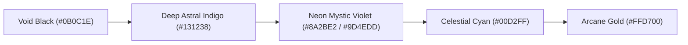
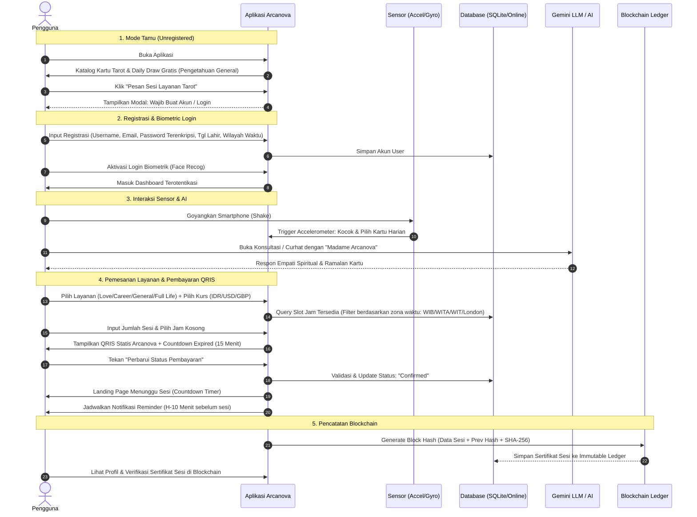

# 🔮 CETAK BIRU PERANCANGAN APLIKASI: ARCANOVA - TAROT READING
> *"Your Story, Written in the Cards"*  
> **Tema Visual**: *Mystic Cosmic Indigo & Neon Violet* dengan aksen *Arcane Gold*

---

## 1. Identitas & Konsep Aplikasi
- **Nama Aplikasi**: ARCANOVA
- **Tagline**: *"Your Story, Written in the Cards"*
- **Deskripsi**: Aplikasi pembacaan tarot modern bernuansa mistik kosmis yang menggabungkan kebijaksanaan arkana kuno dengan teknologi mutakhir: kecerdasan buatan (LLM AI Tarot Consultant), pembuktian sesi tak terhapuskan berbasis *Blockchain Ledger*, interaktivitas sensor gerak (*Shake to Shuffle* & *3D Parallax Tilt*), layanan berbasis lokasi (*LBS Malioboro Offline Sanctuary*), serta sistem pemesanan konsultasi multi-mata uang dan multi-zona waktu.

---

## 2. Pemetaan Kriteria Tugas & Arsitektur Fitur

| No | Kriteria Tugas Dosen | Implementasi Nyata di ARCANOVA | Komponen Teknis (Flutter / Lib) |
|---|---|---|---|
| 1 | **Bahasa Pemrograman Mobile** | Flutter SDK (Dart) cross-platform (Android/iOS) | Dart 3+, Flutter Material 3 |
| 2 | **Login Terenkripsi & Session** | Registrasi & Login dengan hashing password aman (SHA-256 / BCrypt). Token session tersimpan di local storage aman tanpa Firebase Auth. | `crypto`, `bcrypt`, `flutter_secure_storage` |
| 3 | **Login Biometrik** | Face Biometric Authentication (Face Unlock / Face ID) dengan fallback visual mystic face-scan scanner. | `local_auth`, `camera` |
| 4 | **Penyimpanan Lokal & Online** | **Lokal**: SQLite (`sqflite`) untuk cache kartu, riwayat sesi, & blockchain ledger.<br>**Online**: REST API / PostgreSQL (Supabase / Node.js Express) untuk sinkronisasi pesanan & ketersediaan slot jam. | `sqflite`, `path_provider`, `http` / `supabase_flutter` |
| 5 | **Web Service / API & LBS** | LBS Sanctuary Offline di **Jl. Malioboro, Yogyakarta** (hitung jarak radius km, rute peta, & secret discount jika dekat sanctuary). REST API konversi kurs. | `geolocator`, `flutter_map` / `google_maps_flutter`, REST API Currency |
| 6 | **Bottom Navigation (Profil, Saran & Kesan, Logout)** | 5 Menu Utama: Home/Draw, Layanan/Booking, Mystic Games, Arcane AI, dan **Profil** (Foto profil, Saran & Kesan Matkul PAM, Riwayat Blockchain, dan Logout). | `CurvedNavigationBar` / `NavigationBar` M3 |
| 7 | **Konversi Mata Uang (min. 3)** | IDR (Rupiah), USD (Dolar AS), dan GBP (Poundsterling Inggris) terintegrasi langsung pada katalog tarif layanan dan checkout. | Modul `CurrencyConverterService` |
| 8 | **Konversi Waktu (WIB, WITA, WIT, London)** | Terintegrasi pada pemilihan slot waktu sesi konsultasi. User memilih zona waktu lokal, sistem otomatis mengonversi ke WIB, WITA, WIT, dan GMT London. | `intl`, `timezone` |
| 9 | **Minimal 2 Sensor** | 1. **Accelerometer**: *Shake-to-Shuffle* (goyangkan HP untuk mengocok kartu tarot).<br>2. **Gyroscope**: *Mystic 3D Foil Parallax* (miringkan HP untuk efek kilau kartu & bola kristal 3D). | `sensors_plus` |
| 10 | **Fitur AI & LLM** | **Madame Arcanova (AI Tarot Reader & Confidante)**: Chatbot konsultasi dan curhat mistis terpersonalisasi menggunakan Gemini API / OpenAI API. | `google_generative_ai` / REST API LLM |
| 11 | **Mini Games Sederhana** | **Cosmic Love Matcher** (Kecocokan Asmara berbasis nama, gender, & zodiak/tanggal lahir) + **Daily Astral Feng Shui** (Rekomendasi outfit, lucky food, aktivitas). | Modul Game `LoveCompatibilityEngine` |
| 12 | **Pencarian & Pemilihan** | Ensiklopedia Kartu Tarot: Search nama kartu, filter kategori (Major Arcana, Asmara, Karir, Elemen Api/Air/Udara/Tanah), dan pemilihan slot waktu dinamis. | `SearchDelegate`, Filter Chips UI |
| 13 | **Notifikasi Berbasis Mobile** | Notifikasi lokal penjadwalan reminder 10 menit sebelum sesi dimulai ("🔮 *Sesi tarotmu akan dimulai dalam 10 menit!*") dan daily fortune push. | `flutter_local_notifications`, `timezone` |
| 14 | **Blockchain Sederhana** | **Arcane Soul Reading Ledger**: Setiap hasil pembacaan tarot di-seal ke dalam block berantai (Index, Timestamp, Data Hash, Previous Hash, Nonce) anti-tampering. | Modul `SimpleBlockchain` + SHA-256 |

---

## 3. Skema Palet Warna & Desain UI (Mystic Cosmic)



- **Background Utama**: Deep Cosmic Void `#0B0C1E` & Indigo `#131238` (Gradient nebula vertikal).
- **Surface / Card**: Glassmorphism (`BackdropFilter` blur 16px, background `#1A1847` opacity 40%, border neon violet tipis `#8A2BE2` opacity 30%).
- **Primary Accent**: Neon Violet `#9D4EDD` & Electric Purple `#8A2BE2` (untuk tombol interaktif dan glowing text).
- **Secondary Highlight**: Arcane Gold `#FFD700` (untuk aksen nomor kartu tarot, bintang zodiak, dan status transaksi berhasil).
- **Glow Accent**: Celestial Cyan / Aqua `#00D2FF` (untuk indikator LBS, online status, dan garis sensor parallax).
- **Tipografi**: Heading bernuansa mistik elegan (Cinzel / Playfair Display) dan Body teks modern sans-serif (Poppins / Outfit).

---

## 4. Alur Pengguna (User Flow) Lengkap



---

## 5. Rincian Paket Layanan & Konversi Kurs

| Nama Layanan | Durasi | Harga IDR (Rupiah) | Harga USD (Dolar AS) | Harga GBP (Poundsterling) | Deskripsi Spiritual |
|---|---|---|---|---|---|
| **Love Reading** | 30 Menit | **Rp 175.000** | $11.20 | £8.90 | Bedah dinamika asmara, jodoh, *twin flame*, dan solusi konflik cinta masa depan. |
| **Career & Finance** | 30 Menit | **Rp 150.000** | $9.60 | £7.60 | Panduan karir, kelancaran bisnis, peluang investasi, dan hambatan rezeki. |
| **General Reading** | 30 Menit | **Rp 150.000** | $9.60 | £7.60 | Pandangan menyeluruh tentang energi hidup, rintangan saat ini, dan arah langkah terbaik. |
| **Full Life Reading** | 60 Menit | **Rp 300.000** | $19.20 | £15.20 | Eksplorasi mendalam 12 rumah astrologi, karma masa lalu, jalan spiritual, dan takdir hidup. |

> *Catatan*: Nilai konversi dihitung menggunakan kurs dinamis via API atau nilai tukar patokan (1 USD = Rp 15.600, 1 GBP = Rp 19.650) dengan sistem toggle cepat di halaman layanan.

---

## 6. Integrasi Konversi Waktu Sesi (Cross-Timezone Booking)

Sistem database menyimpan jadwal master dalam format **WIB (UTC+7)**, kemudian secara otomatis terkonversi saat ditampilkan ke user:
- **WIB (Waktu Indonesia Barat)**: UTC+7 (Base/Reference)
- **WITA (Waktu Indonesia Tengah)**: UTC+8 (`WIB + 1 jam`)
- **WIT (Waktu Indonesia Timur)**: UTC+9 (`WIB + 2 jam`)
- **London (GMT / BST)**: UTC+0 / UTC+1 (`WIB - 7 jam` atau `WIB - 6 jam`)

**Contoh Tampilan Slot:**
```text
Slot Tersedia:
- Pilihan User (London GMT): 12:00 PM
  [Konversi Otomatis Tertera: 19:00 WIB | 20:00 WITA | 21:00 WIT]
Status: Tersedia (Available)
```

---

## 7. Skema Database (Lokal & Online)

### Tabel 1: `users`
- `id` (INTEGER, Primary Key, Auto Increment)
- `username` (VARCHAR 50, Unique)
- `email` (VARCHAR 100, Unique)
- `password_hash` (VARCHAR 255) — Terenkripsi SHA-256 + Salt
- `birth_date` (DATE) — Digunakan untuk zodiak otomatis & kalkulasi kecocokan
- `timezone_pref` (VARCHAR 20) — Default: 'WIB', 'WITA', 'WIT', atau 'London'
- `avatar_url` (TEXT)
- `biometric_enabled` (BOOLEAN) — Status aktivasi face biometric
- `created_at` (TIMESTAMP)

### Tabel 2: `services`
- `id` (INTEGER, Primary Key)
- `title` (VARCHAR 100)
- `duration_minutes` (INTEGER)
- `price_idr` (INTEGER)
- `price_usd` (DOUBLE)
- `price_gbp` (DOUBLE)
- `description` (TEXT)
- `icon_name` (VARCHAR 50)

### Tabel 3: `bookings`
- `id` (VARCHAR 50, Primary Key) — Kode unik misal: `ARC-20261020-001`
- `user_id` (INTEGER, Foreign Key ke `users.id`)
- `service_id` (INTEGER, Foreign Key ke `services.id`)
- `sessions_count` (INTEGER)
- `session_date` (DATE)
- `session_time_wib` (VARCHAR 10) — Jam acuan WIB (misal: "19:00")
- `total_price` (DOUBLE)
- `currency_used` (VARCHAR 5) — 'IDR', 'USD', atau 'GBP'
- `payment_status` (VARCHAR 20) — 'PENDING_PAYMENT', 'CONFIRMED', 'COMPLETED', 'CANCELLED'
- `qris_reference` (VARCHAR 100)
- `reminder_notified` (BOOLEAN)
- `created_at` (TIMESTAMP)

### Tabel 4: `tarot_cards`
- `id` (INTEGER, Primary Key)
- `name` (VARCHAR 100)
- `arcana_type` (VARCHAR 20) — 'Major Arcana' / 'Minor Arcana'
- `element` (VARCHAR 20) — 'Fire', 'Water', 'Air', 'Earth'
- `upright_meaning` (TEXT)
- `reversed_meaning` (TEXT)
- `love_advice` (TEXT)
- `career_advice` (TEXT)
- `image_path` (VARCHAR 255)

### Tabel 5: `blockchain_ledger` (Sertifikat Pembacaan)
- `block_index` (INTEGER, Primary Key)
- `timestamp` (BIGINT)
- `booking_id` (VARCHAR 50)
- `user_id` (INTEGER)
- `reading_summary` (TEXT)
- `cards_drawn` (TEXT) — List ID kartu yang ditarik
- `previous_hash` (VARCHAR 64)
- `nonce` (INTEGER)
- `current_hash` (VARCHAR 64) — Hash SHA-256

### Tabel 6: `course_feedback` (Menu Saran & Kesan Matkul)
- `id` (INTEGER, Primary Key, Auto Increment)
- `user_id` (INTEGER)
- `student_name` (VARCHAR 100)
- `nim` (VARCHAR 30)
- `kesan` (TEXT)
- `saran` (TEXT)
- `rating_stars` (INTEGER)
- `submitted_at` (TIMESTAMP)

---

## 8. Dataset 22 Kartu Major Arcana Lengkap

Berikut dataset lengkap 22 Kartu Major Arcana untuk ensiklopedia dan pembacaan tarot:

| No | Kartu | Elemen | Kata Kunci | Makna Tegak (Upright) | Makna Terbalik (Reversed) | Nasihat Asmara & Karir |
|---|---|---|---|---|---|---|
| 0 | **The Fool** | Udara | Awal baru, spontanitas, keberanian | Langkah awal kehidupan baru, petualangan tanpa rasa takut. | Kecerobohan, risiko bodoh, ragu-ragu melangkah. | Asmara: Terbuka pada cinta baru. Karir: Saatnya mulai proyek impian. |
| 1 | **The Magician** | Udara | Manifestasi, kekuatan, keahlian | Kemampuan mewujudkan ide menjadi kenyataan dengan sumber daya yang ada. | Manipulasi, potensi terpendam, bakat yang disia-siakan. | Asmara: Komunikasi memikat. Karir: Kuasai keahlian teknis barumu. |
| 2 | **The High Priestess** | Air | Intuisi, misteri, kebijaksanaan batin | Mendengarkan firasat dan suara hati nurani, hal rahasia terungkap. | Mengabaikan intuisi, rahasia terbongkar yang menyakitkan. | Asmara: Ada cinta diam-diam. Karir: Percayai insting analisismu. |
| 3 | **The Empress** | Tanah | Kelimpahan, kesuburan, cinta kasih | Masa panen hasil kerja keras, kreativitas memuncak, kehangatan hubungan. | Ketergantungan emosi, blokade kreativitas, kelelahan. | Asmara: Hubungan semakin harmonis. Karir: Ide bisnis bertumbuh subur. |
| 4 | **The Emperor** | Api | Struktur, stabilitas, kepemimpinan | Disiplin diri, otoritas yang adil, kontrol penuh atas situasi hidup. | Tirani, kontrol berlebihan, kekakuan berpikir. | Asmara: Perlu komitmen jelas. Karir: Waktu tepat mengambil peran pimpinan. |
| 5 | **The Hierophant** | Tanah | Tradisi, etika, bimbingan spiritual | Menghormati nilai moral, belajar dari mentor, komitmen spiritual. | Pemberontakan tak berarah, fanatisme dogma kaku. | Asmara: Menuju pelaminan/restu keluarga. Karir: Ikuti SOP dan etika kerja. |
| 6 | **The Lovers** | Udara | Pilihan hati, harmoni, belahan jiwa | Keputusan besar moral/hati, persatuan dua jiwa yang saling melengkapi. | Disharmoni, ketidakcocokan nilai, godaan perselingkuhan. | Asmara: Koneksi batin mendalam. Karir: Kolaborasi kemitraan saling untung. |
| 7 | **The Chariot** | Air | Tekad baja, kemenangan, fokus | Mengatasi rintangan berat dengan kendali emosi dan tekad kuat. | Kehilangan kendali, agresi tak terkendali, kekalahan. | Asmara: Perjuangkan cintamu. Karir: Target tercapai melalui ketekunan tinggi. |
| 8 | **Strength** | Api | Keberanian lembut, kesabaran, daya tahan | Menundukkan ego liar dengan kelembutan hati dan ketenangan batin. | Keraguan diri, ketakutan batin, meledak-ledak. | Asmara: Selesaikan masalah dengan sabar. Karir: Hadapi tekanan kerja dengan tenang. |
| 9 | **The Hermit** | Tanah | Introspeksi, kontemplasi, pencerahan | Menepi dari kebisingan untuk mencari kebenaran jati diri. | Kesepian berlarut, isolasi diri toksik, menolak bantuan. | Asmara: Kenali diri sebelum mencintai. Karir: Evaluasi arah jangka panjang. |
| 10 | **Wheel of Fortune** | Api | Takdir, siklus hidup, keberuntungan | Roda nasib berputar ke atas, peluang tak terduga, hukum karma baik. | Nasib buruk sementara, resistensi terhadap perubahan hidup. | Asmara: Pertemuan jodoh tak terduga. Karir: Rezeki nomplok segera datang. |
| 11 | **Justice** | Udara | Keadilan, kejujuran, konsekuensi | Kebenaran ditegakkan, keputusan adil, hukum sebab akibat seimbang. | Ketidakadilan, kebohongan, penyangkalan tanggung jawab. | Asmara: Saling transparan tanpa rahasia. Karir: Kontrak hukum selesai tuntas. |
| 12 | **The Hanged Man** | Air | Penyerahan, sudut pandang baru, jeda | Berhenti sejenak melepaskan ego demi pemahaman spiritual yang lebih tinggi. | Pengorbanan sia-sia, keras kepala, menunda-nunda waktu. | Asmara: Lihat sudut pandang pasangan. Karir: Jangan paksakan jalan buntu. |
| 13 | **Death** | Air | Transformasi total, akhir siklus, kelahiran kembali | Berakhirnya masa lalu untuk membuka lembaran baru yang lebih bermakna. | Takut perubahan, melekat pada masa lalu yang beracun. | Asmara: Lepaskan mantan toksik. Karir: Pivot karir menuju industri baru. |
| 14 | **Temperance** | Api | Keseimbangan, moderasi, penyembuhan | Menyatukan perbedaan secara harmonis, sabar mengalir dengan waktu. | Ketidakseimbangan, ekstremitas, konflik emosi yang panas. | Asmara: Kompromi sehat dua insan. Karir: Seimbangkan kerja dan istirahat. |
| 15 | **The Devil** | Tanah | Godaan, keterikatan, materialisme | Terjebak dalam ilusi kenikmatan semu atau kecanduan yang membelenggu. | Melepaskan belenggu, kesadaran membebaskan diri. | Asmara: Waspada obsesi posesif. Karir: Jangan ambil jalan pintas kotor. |
| 16 | **The Tower** | Api | Kejutan besar, keruntuhan ego, pembebasan | Guncangan mendadak meruntuhkan kepalsuan agar fondasi sejati terbangun. | Menghindari krisis yang tak terelakkan, takut runtuh. | Asmara: Badai kejujuran membuka mata. Karir: Rencana batal membawa hikmah. |
| 17 | **The Star** | Udara | Harapan, inspirasi batin, kedamaian | Cahaya terang setelah kegelapan, pemulihan energi batin, optimisme. | Kehilangan harapan, pesimisme, ketidakpercayaan diri. | Asmara: Cinta penuh kedamaian batin. Karir: Prospek cerah di masa depan. |
| 18 | **The Moon** | Air | Ilusi, intuisi bawah sadar, ketakutan | Navigasi dalam kegelapan emosi, jangan terburu-buru menilai bayangan. | Terlepas dari ketakutan paranoia, fakta mulai terang. | Asmara: Hati-hati kesalahpahaman. Karir: Waspada informasi yang abu-abu. |
| 19 | **The Sun** | Api | Sukacita, vitalitas, keberhasilan mutlak | Keberhasilan gemilang, kejelasan hati nurani, kehangatan hidup. | Awan mendung sesaat, kesombongan, kebahagiaan tertunda. | Asmara: Kebahagiaan luar biasa berdua. Karir: Prestasi diakui luas. |
| 20 | **Judgement** | Api | Kebangkitan nurani, evaluasi hidup, panggilan jiwa | Menemukan panggilan jiwa tertinggi, memaafkan kesalahan masa lalu. | Menghakimi diri terlalu keras, penyesalan tak berujung. | Asmara: Rekonsiliasi dengan jiwa bersih. Karir: Naik tingkat secara profesional. |
| 21 | **The World** | Tanah | Kesempurnaan, kepuasan akhir, siklus utuh | Tercapainya tujuan puncak, harmoni dengan semesta, kelulusan ujian. | Pekerjaan belum tuntas, penundaan di garis akhir. | Asmara: Komitmen paripurna abadi. Karir: Sukses besar proyek utama. |

---

## 9. Fitur Sensor: Mekanika & Implementasi

### 1. Accelerometer: "Shake to Shuffle" (Kocok Kartu)
- **Konsep**: Pengguna memegang smartphone di tangan, lalu menggoyangkan perangkat dengan ritme cepat untuk mengocok tumpukan kartu mistis.
- **Logika Nilai**: Menghitung percepatan gerak $g = \sqrt{x^2 + y^2 + z^2}$. Jika $g > 15 \text{ m/s}^2$ secara berulang minimal 3 kali dalam jendela waktu 1,5 detik:
  - Aktifkan efek getaran Haptic Feedback (`HapticFeedback.heavyImpact()`).
  - Putar animasi suara shuffle kartu mistis.
  - Kartu harian otomatis terlempar keluar dari tumpukan deck.

### 2. Gyroscope: "Mystic 3D Parallax & Crystal Ball Tilt"
- **Konsep**: Saat pengguna melihat kartu tarot atau bola kristal, memiringkan sudut smartphone akan membelokkan sudut cahaya holografik foil emas dan mengubah bayangan nebula secara realtime.
- **Logika Nilai**: Membaca parameter rotasi `rotationRate.x` (pitch) dan `rotationRate.y` (roll):
  - Menggeser offset bayangan dan gradien cahaya linear kartu menggunakan `Transform(transform: Matrix4.identity()..setEntry(3, 2, 0.001)..rotateX(pitch * 0.1)..rotateY(roll * 0.1))`.
  - Menghasilkan sensasi visual 3D berkilau mewah.

---

## 10. Fitur LBS: Offline Sanctuary Malioboro

- **Nama Lokasi**: *Arcanova Mystic Sanctuary Yogyakarta*
- **Alamat**: Jl. Malioboro No. 56, Sosromenduran, Gedong Tengen, Kota Yogyakarta, D.I. Yogyakarta 55271
- **Koordinat GPS**: Latitude `-7.792849`, Longitude `110.365851`
- **Fitur LBS**:
  1. **Radius Radar**: Menghitung jarak realtime dari lokasi GPS pengguna ke Malioboro menggunakan rumus Haversine (`Geolocator.distanceBetween()`).
  2. **Secret Astral Aura Discount**: Jika pengguna membuka aplikasi dalam radius $\le 1.0\text{ km}$ dari Malioboro, aplikasi memunculkan banner eksklusif:  
     *"✨ Aura Malioboromu Terdeteksi! Dapatkan diskon 20% untuk Walk-in Reading di Sanctuary kami hari ini."*
  3. **Rute & Arahan**: Tombol "Navigasi ke Sanctuary" yang langsung membuka Google Maps rute perjalanan ke lokasi.

---

## 11. Fitur Mini Games: Cosmic Love Matcher & Daily Feng Shui

### A. Cosmic Love Matcher (Kecocokan Cinta)
- **Input**:
  - Pasangan 1: Nama, Gender, Tanggal Lahir (otomatis mendeteksi Zodiak & Elemen)
  - Pasangan 2: Nama, Gender, Tanggal Lahir (otomatis mendeteksi Zodiak & Elemen)
- **Algoritma**:
  - Matriks Kompatibilitas Elemen Astrologi:
    - *Fire + Air* = Harmonis (85% - 98%)
    - *Earth + Water* = Subur & Kokoh (88% - 96%)
    - *Fire + Water* = Penuh Gejolak Gairah (60% - 75%)
    - *Air + Earth* = Perlu Kompromi Logika (55% - 70%)
  - Numerologi Nama: Menghitung nilai huruf Pythagorean $(A=1, B=2, \dots)$ modulo penyeimbang.
- **Output**:
  - Persentase Kecocokan (misal: **92% - Soulmate Frequency**)
  - Ringkasan Dinamika Hubungan (Kelebihan & Tantangan)
  - Saran Asmara Tarot harian untuk pasangan tersebut.

### B. Daily Astral Feng Shui & Lucky Guide
- **Rekomendasi Harian**:
  - **Outfit Lucky Color**: Warna busana penarik energi positif hari ini (misal: *Lavender & Royal Gold*).
  - **Lucky Activity**: Aktivitas penyelarasan aura (misal: *Meditasi senja, menulis jurnal rasa syukur, hindari perdebatan finansial*).
  - **Lucky Food**: Santapan penyeimbang elemen cakra (misal: *Teh chamomile hangat, kacang almond, buah delima*).

---

## 12. Fitur AI & LLM: Madame Arcanova (Tarot Confidante)

- **Engine**: Google Gemini 1.5 Flash / Pro (via API Key).
- **System Prompt Mistis**:
  > *"Kamu adalah Madame Arcanova, seorang pembaca kartu tarot dan konsultan spiritual bijaksana, penuh empati, anggun, dan berwawasan luas. Gaya bicaramu menggunakan bahasa Indonesia yang puitis, menenangkan, misterius namun solutif dan realistis. Kamu tidak menakut-nakuti pengguna, melainkan memberikan sudut pandang bijak berdasarkan simbolisme kartu tarot, psikologi emosi, dan energi kosmis. Sapalah pengguna dengan lembut seperti 'Sahabat Jiwaku'. Jawablah curhat mereka dengan menghubungkan pada kartu arkana yang relevan."*
- **Fitur Chat**:
  - Mode Curhat Asmara, Karir, dan Beban Emosional.
  - Kemampuan menarik kartu tarot virtual langsung di dalam ruang chat AI dan menginterpretasikan maknanya terhadap permasalahan user.

---

## 13. Blockchain Sederhana: Arcane Soul Ledger

Setiap kali pengguna menyelesaikan sesi konsultasi atau *Major Life Reading*, sistem mencatat sertifikat ke dalam rantai blok (*blockchain ledger*) lokal:

```dart
class ArcaneBlock {
  final int index;
  final int timestamp;
  final Map<String, dynamic> sessionData;
  final String previousHash;
  final int nonce;
  final String hash;

  ArcaneBlock({
    required this.index,
    required this.timestamp,
    required this.sessionData,
    required this.previousHash,
    required this.nonce,
    required this.hash,
  });
}
```

- **Mekanisme**:
  - Data yang di-hash: `index + timestamp + jsonEncode(sessionData) + previousHash + nonce`.
  - Fungsi Hash: `SHA-256`.
  - Nilai Genesis Block: Block pertama `#0` diinisialisasi oleh sistem: *"Genesis of Arcanova Sanctuary"*.
  - Di profil pengguna ada tombol: **"Verifikasi Sertifikat Rantai Jiwa"** yang menghitung ulang validitas hash seluruh rantai secara transparan.

---

## 14. Struktur Menu Bottom Navigation & Pengaturan

1. 🌌 **Home / Card Deck**: Katalog 22 Major Arcana, search bar, filter elemen, *Shake-to-Shuffle daily draw*.
2. 🔮 **Layanan (Reading)**: 4 Paket Layanan Tarot, pemilihan mata uang (IDR, USD, GBP), booking slot waktu (WIB, WITA, WIT, London), pembayaran QRIS statis, dan status sesi.
3. 🎮 **Mystic Hub**: Game Kecocokan Cinta (Love Matcher), Astral Feng Shui harian, dan Radar Lokasi Offline Sanctuary Malioboro (LBS).
4. 🕯️ **Arcane AI**: Ruang konsultasi dan curhat spiritual interaktif bersama *Madame Arcanova*.
5. 👤 **Profil Pengguna**:
   - Foto avatar profil & badge tingkat spiritual.
   - Status Biometrik Wajah (Toggle Face Unlock).
   - Riwayat Sesi & Verifikasi *Blockchain Reading Ledger*.
   - **Menu Khusus**: *"Saran dan Kesan Mata Kuliah Pemrograman Aplikasi Mobile"* (Form input + Rating + Riwayat masukan mahasiswa).
   - Tombol **Logout** (Membersihkan session token secara aman).

---

## 15. Sistematika Format Laporan Tugas Akhir (RBPL/RPL)

Sesuai ketentuan dosen, laporan disusun dengan struktur berikut:

1. **Cover Laporan**: Judul Proyek, Logo Universitas, Nama Anggota Kelompok & NIM, Program Studi, Fakultas, Tahun Akademik.
2. **Halaman Pengesahan**: Ditandatangani Dosen Pengampu Mata Kuliah Pemrograman Aplikasi Mobile.
3. **Daftar Isi, Daftar Gambar, Daftar Tabel**.
4. **BAB I: Pendahuluan & Landasan Teori**:
   - Latar belakang pemilihan tema aplikasi *Arcanova*.
   - Landasan teori: Mobile Development (Flutter), Enkripsi Hashing, Biometrik, LBS, Sensor HP, LLM AI, dan Blockchain Ledger.
5. **BAB II: Perancangan Sistem (RBPL / RPL)**:
   - Identifikasi Kebutuhan Sistem (Functional & Non-Functional Requirements).
   - Use Case Diagram & Skenario Use Case.
   - Activity Diagram & Sequence Diagram.
   - Entity Relationship Diagram (ERD) & Relasi Antar Tabel.
   - Desain Wireframe / Mockup UI (Figma to Flutter).
6. **BAB III: Implementasi & Penjelasan Source Code**:
   - Implementasi Struktur Folder & Dependency.
   - Source Code Hashing Enkripsi & Session.
   - Source Code Face Biometrics (`local_auth`).
   - Source Code Database SQLite & API Online.
   - Source Code Sensor Accelerometer & Gyroscope.
   - Source Code LBS Malioboro & Geolocation.
   - Source Code AI Gemini & Simple Blockchain Ledger.
   - Screenshot antarmuka setiap halaman aplikasi.
7. **BAB IV: Lembar Evaluasi & Pengujian Perangkat Lunak**:
   - Pengujian fungsionalitas menggunakan metode *Black Box Testing* (Tabel Kasus Uji, Masukan, Hasil yang Diharapkan, Hasil Pengujian, Status Pass/Fail).
   - Evaluasi performa sensor & biometric device.
8. **BAB V: Saran & Kesan Matkul**:
   - Rekapitulasi kesan mendalam dan saran konstruktif untuk mata kuliah Pemrograman Aplikasi Mobile.
9. **Daftar Pustaka & Lampiran**.
