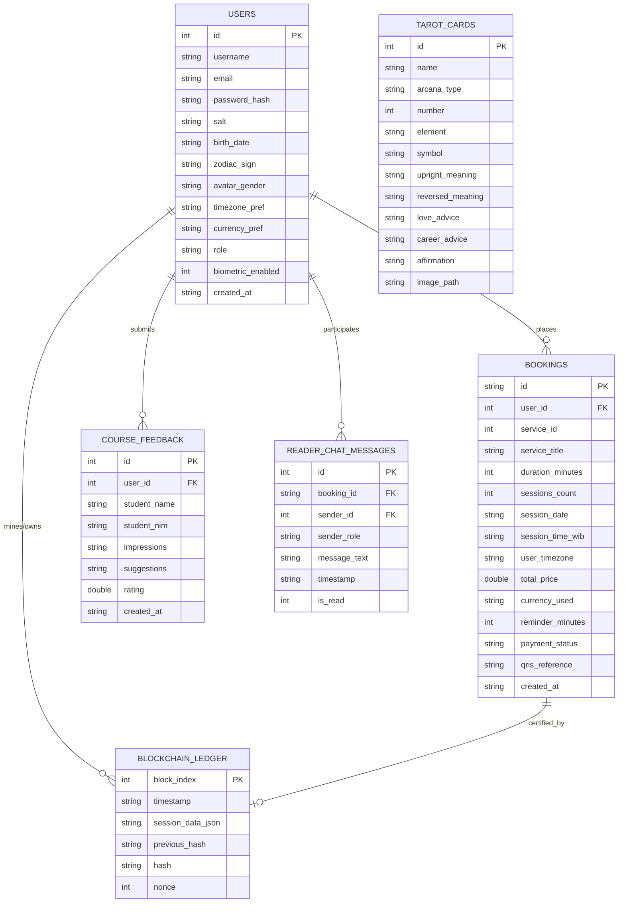
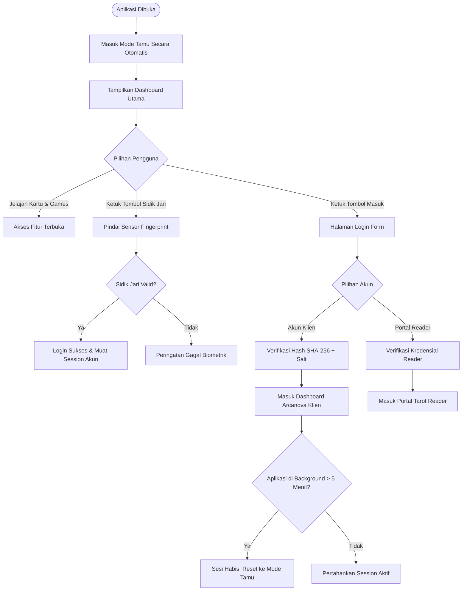
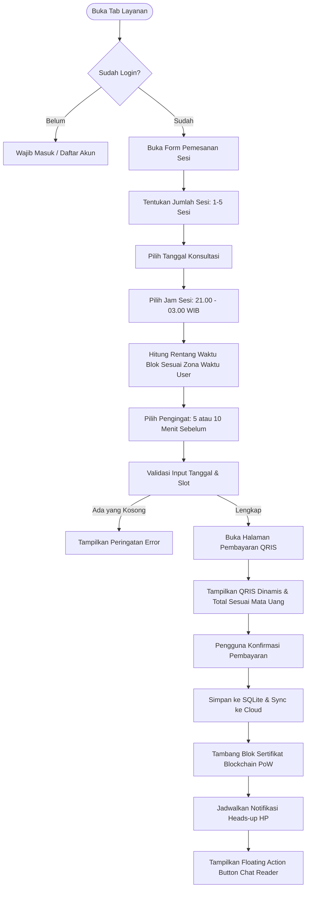
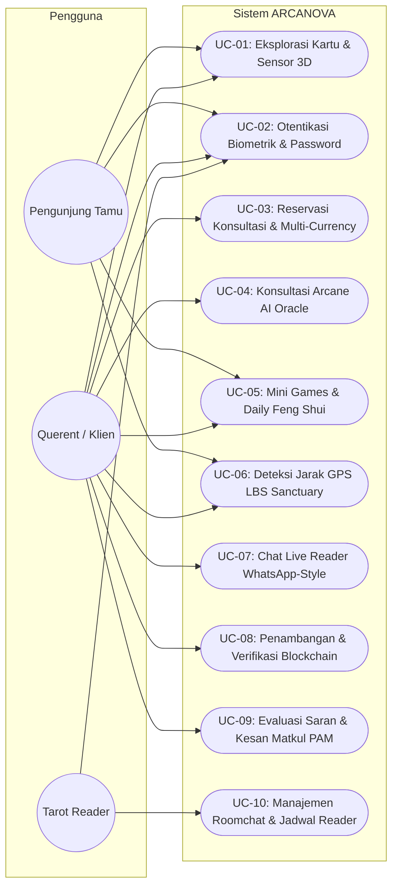
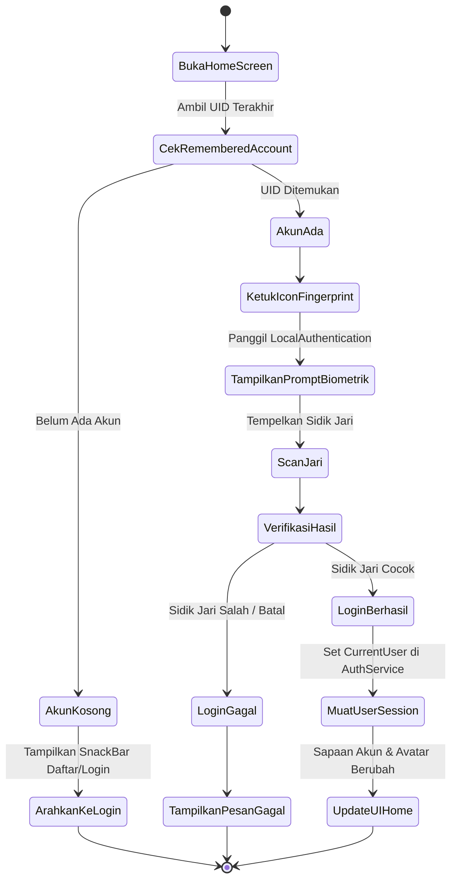
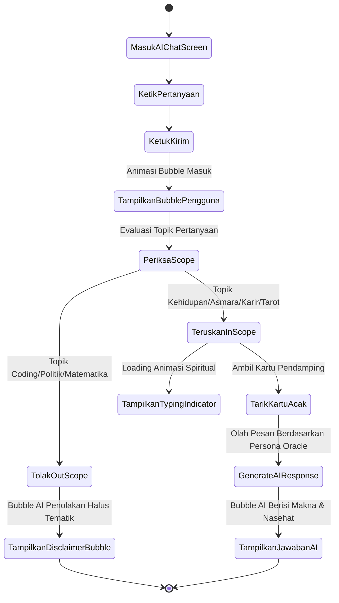
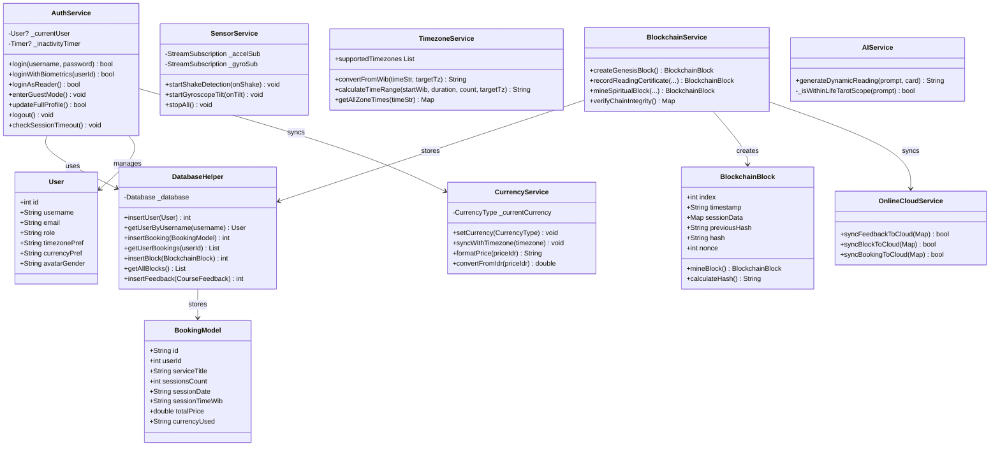
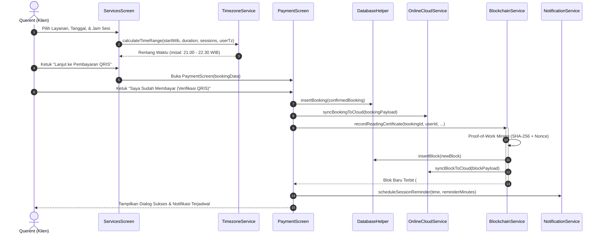
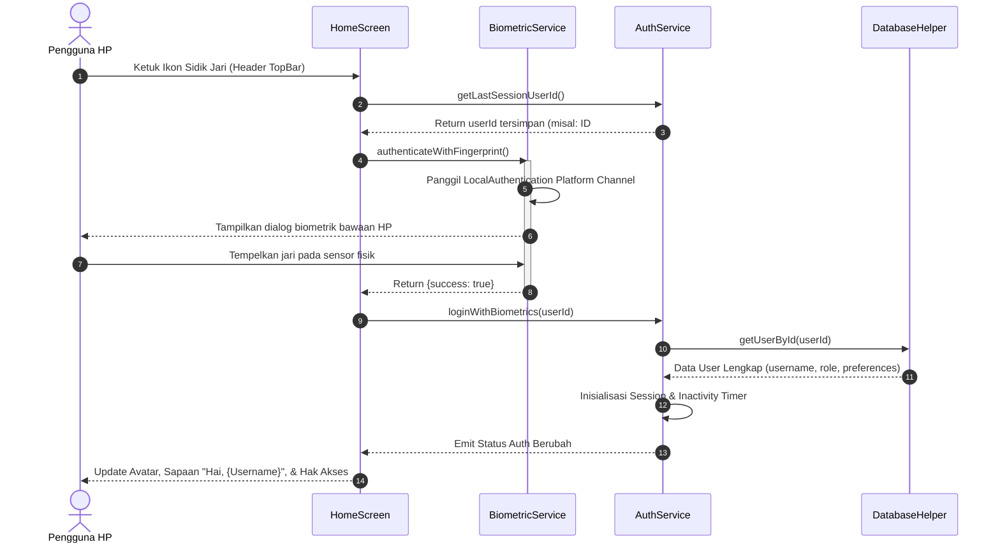

# DOKUMEN IMPLEMENTASI KRITERIA TUGAS & PERANCANGAN SISTEM
## PROYEK AKHIR: ARCANOVA - MYSTIC TAROT READING & SPIRITUAL SANCTUARY

---

> [!NOTE]
> Dokumen ini disusun sebagai acuan pengujian, presentasi, dan penilaian tugas mata kuliah **Pemrograman Aplikasi Mobile (PAM)**. Dokumen ini memetakan seluruh kriteria penilaian dosen ke implementasi baris kode sumber serta menyediakan diagram rekayasa perangkat lunak lengkap (UML & Data Modeling).

---

## 1. PEMETAAN LENGKAP KRITERIA TUGAS & LOKASI KODE

| No | Kriteria Tugas Dosen | Status | File Implementasi | Komponen / Method Utama | Penjelasan & Bukti Fitur |
|---|---|---|---|---|---|
| **1** | **Konsep Projek Akhir** | ✅ Terpenuhi | Seluruh direktori `lib/` | Tema Mystic Purple-Blue (Dark Astral) | ARCANOVA adalah aplikasi bimbingan spiritual, pembacaan tarot 78 kartu Major/Minor Arcana, konsultasi live dengan tarot reader asli, dan reservasi sanctuary offline. |
| **2** | **Login dengan Enkripsi (Tanpa Firebase) & Session** | ✅ Terpenuhi | [`lib/services/auth_service.dart`](file:///c:/Users/ASUS/OneDrive/Documents/Semester5/Mobile/finalproject/lib/services/auth_service.dart) | `hashPassword()`, `register()`, `login()`, `checkSessionTimeout()`, `enterGuestMode()` | Menggunakan enkripsi satu arah **SHA-256 dipadu Unique Salt**. Tidak bergantung pada Firebase. Session login otomatis logout jika aplikasi ditinggalkan di latar belakang lebih dari **5 menit** (300 detik). Saat pertama dibuka, aplikasi langsung masuk **Mode Tamu (Guest)**. |
| **3** | **Login Biometrik Sidik Jari** | ✅ Terpenuhi | [`lib/services/biometric_service.dart`](file:///c:/Users/ASUS/OneDrive/Documents/Semester5/Mobile/finalproject/lib/services/biometric_service.dart) [`lib/views/home/home_screen.dart`](file:///c:/Users/ASUS/OneDrive/Documents/Semester5/Mobile/finalproject/lib/views/home/home_screen.dart) | `authenticateWithFingerprint()`, `_quickFingerprintLogin()` | Menggunakan sensor sidik jari hardware (`local_auth`). Tombol fingerprint cepat di pojok atas HomeScreen memungkinkan akun tersimpan langsung login instan tanpa mengetik password. |
| **4** | **Database Lokal & Cloud** | ✅ Terpenuhi | **Lokal:** [`lib/services/db_helper.dart`](file:///c:/Users/ASUS/OneDrive/Documents/Semester5/Mobile/finalproject/lib/services/db_helper.dart) **Cloud:** [`lib/services/online_cloud_service.dart`](file:///c:/Users/ASUS/OneDrive/Documents/Semester5/Mobile/finalproject/lib/services/online_cloud_service.dart) | SQLite `arcanova_master_v4.db` Cloud RESTful API: `syncFeedbackToCloud()`, `syncBlockToCloud()`, `syncBookingToCloud()` | **Lokal (SQLite):** 6 tabel relasional (`users`, `bookings`, `course_feedback`, `blockchain_ledger`, `tarot_cards`, `reader_chat_messages`). **Cloud/Online:** Sinkronisasi online masukan matkul, sertifikat blockchain, dan order pembayaran via REST API endpoint. |
| **5** | **Web Service / REST API** | ✅ Terpenuhi | [`lib/services/lbs_service.dart`](file:///c:/Users/ASUS/OneDrive/Documents/Semester5/Mobile/finalproject/lib/services/lbs_service.dart) [`lib/services/currency_service.dart`](file:///c:/Users/ASUS/OneDrive/Documents/Semester5/Mobile/finalproject/lib/services/currency_service.dart) [`lib/views/games/mystic_hub_screen.dart`](file:///c:/Users/ASUS/OneDrive/Documents/Semester5/Mobile/finalproject/lib/views/games/mystic_hub_screen.dart) | Nominatim OpenStreetMap API, Yandex Static Maps API, Google Maps Navigation, ExchangeRate API | 1. `https://nominatim.openstreetmap.org/reverse` (Reverse Geocoding kota & provinsi GPS). 2. `https://static-maps.yandex.ru/1.x/` (Gambar peta real-time sanctuary). 3. `https://www.google.com/maps/dir/` (Navigasi Maps). 4. `https://open.er-api.com/v6/latest/USD` (Kurs konversi live). |
| **6** | **Fasilitas LBS (Location Based Service)** | ✅ Terpenuhi | [`lib/services/lbs_service.dart`](file:///c:/Users/ASUS/OneDrive/Documents/Semester5/Mobile/finalproject/lib/services/lbs_service.dart) [`lib/views/games/mystic_hub_screen.dart`](file:///c:/Users/ASUS/OneDrive/Documents/Semester5/Mobile/finalproject/lib/views/games/mystic_hub_screen.dart) | `calculateDistance()`, `getCurrentCityName()`, `openSanctuaryInMaps()` | Menghitung jarak GPS riil dari koordinat user ke Sanctuary Malioboro Yogyakarta via rumus Haversine. Jika user berada dalam radius <= 1.5 km, memicu **Diskon 20% Aura Zone**. Menampilkan nama kota pengguna (misal: Kota Semarang, Jawa Tengah). |
| **7** | **Bottom Navigation Bar (Profil, Saran-Kesan PAM, Logout)** | ✅ Terpenuhi | [`lib/views/main_navigation.dart`](file:///c:/Users/ASUS/OneDrive/Documents/Semester5/Mobile/finalproject/lib/views/main_navigation.dart) [`lib/views/feedback/course_feedback_screen.dart`](file:///c:/Users/ASUS/OneDrive/Documents/Semester5/Mobile/finalproject/lib/views/feedback/course_feedback_screen.dart) [`lib/views/profile/profile_screen.dart`](file:///c:/Users/ASUS/OneDrive/Documents/Semester5/Mobile/finalproject/lib/views/profile/profile_screen.dart) | 6 Menu Navigasi: Home, Deck, Mystic Hub, Layanan, **Saran & Kesan PAM**, Profil | Bottom bar menampung menu profil lengkap (avatar cewek/cowok, edit email/username/password/timezone/currency, tombol logout), serta menu khusus **Saran dan Kesan Perkuliahan PAM** (rating bintang & form masukan tersimpan di SQLite dan Cloud). |
| **8** | **Konversi Mata Uang & Konversi Waktu** | ✅ Terpenuhi | [`lib/services/currency_service.dart`](file:///c:/Users/ASUS/OneDrive/Documents/Semester5/Mobile/finalproject/lib/services/currency_service.dart) [`lib/services/timezone_service.dart`](file:///c:/Users/ASUS/OneDrive/Documents/Semester5/Mobile/finalproject/lib/services/timezone_service.dart) [`lib/views/booking/services_screen.dart`](file:///c:/Users/ASUS/OneDrive/Documents/Semester5/Mobile/finalproject/lib/views/booking/services_screen.dart) | `convertFromIdr()`, `convertFromWib()`, `calculateTimeRange()`, `syncWithTimezone()` | **Mata Uang (3):** IDR, USD ($), GBP (£). Zona WIB/WITA/WIT otomatis terkunci ke IDR; zona London GMT memungkinkan pemilihan USD atau GBP di profil. **Waktu (4):** WIB, WITA, WIT, London GMT. Jadwal malam buka 21.00 - 03.00 WIB (interval 30 menit). Menghitung rentang blok (contoh: 21.00 - 22.30 WIB untuk 3 sesi). |
| **9** | **Minimal 2 Sensor HP Sesuai Konsep** | ✅ Terpenuhi | [`lib/services/sensor_service.dart`](file:///c:/Users/ASUS/OneDrive/Documents/Semester5/Mobile/finalproject/lib/services/sensor_service.dart) [`lib/views/home/home_screen.dart`](file:///c:/Users/ASUS/OneDrive/Documents/Semester5/Mobile/finalproject/lib/views/home/home_screen.dart) | 1. **Accelerometer:** `startShakeDetection()` 2. **Gyroscope:** `startGyroscopeTilt()` | **Sensor 1 (Accelerometer):** Menggoyang (shake) HP untuk mengacak dan menarik kartu harian secara fisik. **Sensor 2 (Gyroscope):** Memiringkan HP memutar kartu harian dalam efek rotasi 3D Holographic Parallax (`Matrix4`), dilengkapi **HUD Telemetri Gyroscope Live** (`Pitch` & `Roll`) dan drag-pan fallback untuk pengujian emulator. |
| **10** | **Fitur AI & LLM Sesuai Konsep** | ✅ Terpenuhi | [`lib/services/ai_service.dart`](file:///c:/Users/ASUS/OneDrive/Documents/Semester5/Mobile/finalproject/lib/services/ai_service.dart) [`lib/views/ai_chat/ai_chat_screen.dart`](file:///c:/Users/ASUS/OneDrive/Documents/Semester5/Mobile/finalproject/lib/views/ai_chat/ai_chat_screen.dart) | `generateDynamicReading()`, `_isWithinLifeTarotScope()` | **Arcane AI Oracle**: Asisten batin AI yang merespon input pengguna secara real-time dan dinamis seputar kehidupan, asmara, karir, kuliah, dan ramalan kartu tarot. Dilengkapi **Scope Filter** (jika ditanya di luar topik batin seperti koding atau politik, AI menampilkan bubble penolakan halus). |
| **11** | **Mini Games Sederhana Tematik** | ✅ Terpenuhi | [`lib/views/games/mystic_hub_screen.dart`](file:///c:/Users/ASUS/OneDrive/Documents/Semester5/Mobile/finalproject/lib/views/games/mystic_hub_screen.dart) | Tab 1: Astral Love Matcher Tab 2: Astral Daily Feng Shui | **Astral Love Matcher:** Game ramalan asmara dengan pemilihan gender ber-outline warna unik (pria: cyan/biru, wanita: pink/ungu), kalkulasi zodiak lahir, dan persentase kecocokan. **Daily Feng Shui:** Generator tips energi harian, arah rezeki, dan rekomendasi warna pakaian. |
| **12** | **Fasilitas Pencarian dan Pemilihan** | ✅ Terpenuhi | [`lib/views/home/home_screen.dart`](file:///c:/Users/ASUS/OneDrive/Documents/Semester5/Mobile/finalproject/lib/views/home/home_screen.dart) [`lib/views/cards/deck_screen.dart`](file:///c:/Users/ASUS/OneDrive/Documents/Semester5/Mobile/finalproject/lib/views/cards/deck_screen.dart) | `_searchQuery`, `_selectedElement`, `_filterCards()` | Kolom pencarian teks instan nama kartu tarot (78 kartu) dan pemilihan chip elemen (*Semua, Fire, Water, Air, Earth*) dengan visualisasi warna elemen yang responsif. |
| **13** | **Fitur Notifikasi Berbasis Mobile** | ✅ Terpenuhi | [`lib/services/notification_service.dart`](file:///c:/Users/ASUS/OneDrive/Documents/Semester5/Mobile/finalproject/lib/services/notification_service.dart) [`lib/views/booking/services_screen.dart`](file:///c:/Users/ASUS/OneDrive/Documents/Semester5/Mobile/finalproject/lib/views/booking/services_screen.dart) | `scheduleSessionReminder()`, `sendDailyFengShuiNotification()` | Notifikasi heads-up popup di luar aplikasi (Android 13+ Notification Runtime Permission, High Importance Channel). Pilihan pengingat 5 atau 10 menit sebelum sesi konsultasi dimulai, dan Floating Action Button (FAB) ber-badge unread saat ada sesi aktif. |
| **14** | **Fitur Blockchain Sederhana** | ✅ Terpenuhi | [`lib/services/blockchain_service.dart`](file:///c:/Users/ASUS/OneDrive/Documents/Semester5/Mobile/finalproject/lib/services/blockchain_service.dart) [`lib/models/blockchain_block.dart`](file:///c:/Users/ASUS/OneDrive/Documents/Semester5/Mobile/finalproject/lib/models/blockchain_block.dart) [`lib/views/profile/profile_screen.dart`](file:///c:/Users/ASUS/OneDrive/Documents/Semester5/Mobile/finalproject/lib/views/profile/profile_screen.dart) | `recordReadingCertificate()`, `mineSpiritualBlock()`, `verifyChainIntegrity()` | **Aktif & Tidak Statis:** Setiap sesi konsultasi ditambang (mined) dengan algoritma **Proof-of-Work (PoW)** dan di-hash menggunakan **SHA-256** menjadi sertifikat batin immutable. Terdapat tombol **"Tambang Blok Baru"** di profil untuk menambang secara manual, tombol **"Verifikasi Hash"** untuk memeriksa validitas `previousHash`, dan modal detail kriptografi per blok. |
| **15** | **Multi-Role (Client & Tarot Reader)** | ✅ Terpenuhi | [`lib/views/reader_portal/reader_portal_screen.dart`](file:///c:/Users/ASUS/OneDrive/Documents/Semester5/Mobile/finalproject/lib/views/reader_portal/reader_portal_screen.dart) [`lib/views/auth/login_screen.dart`](file:///c:/Users/ASUS/OneDrive/Documents/Semester5/Mobile/finalproject/lib/views/auth/login_screen.dart) | Role: `client` vs `reader` (`isReader`), H+3 Session Retention | Dua antarmuka terpisah: Klien mengakses dashboard tarot utama. Akun Reader (`username: reader`, `password: reader123`) memiliki **Tarot Reader Portal** tersendiri untuk mengelola roomchat konsultasi WhatsApp-style yang otomatis terhapus setelah 3 hari (H+3) dan memantau jadwal sesi booked. |

---

## 2. DIAGRAM PERANCANGAN SISTEM (SOFTWARE ENGINEERING)

### 2.1 Entity Relationship Diagram (ERD)
Diagram berikut menggambarkan struktur basis data SQLite lokal (`arcanova_master_v4.db`) dan relasi antar entitas:

---

### 2.2 System Flowchart

#### A. Alur Autentikasi, Mode Tamu, & Session Timeout

#### B. Alur Reservasi Konsultasi & Pembayaran QRIS Dinamis

---

### 2.3 Use Case Diagram & Deskripsi Use Case

#### Deskripsi Terstruktur Use Case Terpilih:

| Elemen Use Case | Deskripsi Rinci |
|---|---|
| **Use Case ID** | **UC-03: Reservasi Konsultasi & Multi-Currency** |
| **Aktor** | Querent / Klien Terdaftar |
| **Deskripsi** | Pengguna memilih paket layanan tarot malam (21.00 - 03.00 WIB), menentukan jumlah sesi dan slot waktu yang otomatis dikonversi ke zona waktu profilnya (WIB, WITA, WIT, London GMT), serta menyelesaikan pembayaran QRIS dalam mata uang terkait (IDR, USD, GBP). |
| **Preconditions** | Pengguna telah login ke dalam akun klien ARCANOVA. |
| **Trigger** | Pengguna menekan tombol "Pesan Sekarang" pada kartu layanan di `ServicesScreen`. |
| **Main Flow** | 1. Pengguna menentukan jumlah sesi konsultasi (1-5 sesi). 2. Pengguna memilih tanggal bimbingan batin. 3. Pengguna memilih jam sesi yang tersedia. 4. Sistem menghitung rentang blok waktu konsultasi (contoh: 21.00 - 22.30 WIB). 5. Pengguna memilih jeda pengingat notifikasi (5 atau 10 menit sebelum mulai). 6. Pengguna menekan tombol "Lanjut ke Pembayaran QRIS". 7. Sistem membuat invoice dan menampilkan barcode QRIS dinamis. 8. Pengguna mengonfirmasi bayar; pesanan dicatat di SQLite dan Cloud, pengingat dijadwalkan, dan blok blockchain ditambang. |
| **Alternate Flow** | Jika tanggal atau jam belum dipilih, sistem menampilkan peringatan SnackBar kesalahan input dan mencegah navigasi ke pembayaran. |
| **Postconditions** | Record pesanan tersimpan, status pembayaran lunas, sertifikat blockchain terbit, dan Floating Action Button untuk chat live dengan reader aktif. |

| Elemen Use Case | Deskripsi Rinci |
|---|---|
| **Use Case ID** | **UC-08: Penambangan & Verifikasi Blockchain** |
| **Aktor** | Querent / Klien Terdaftar, Sistem Otomatis |
| **Deskripsi** | Pengguna melakukan pencatatan sertifikat bimbingan batin ke dalam rantai blok terenkripsi SHA-256 menggunakan Proof-of-Work (PoW) serta memvalidasi keaslian hash rantai. |
| **Preconditions** | Basis data lokal memiliki Genesis Block (#0). |
| **Trigger** | Transaksi konsultasi sukses (otomatis) atau pengguna menekan tombol "Tambang" di ProfileScreen (manual). |
| **Main Flow** | 1. Pengguna memasukkan niat atau data konsultasi spiritual. 2. Pengguna menekan tombol "Mulai Tambang (PoW)". 3. Sistem menjalankan loop Proof-of-Work mencari nilai `nonce` yang menghasilkan hash dengan prefix difficulty. 4. Blok baru terbentuk dengan tautan `previousHash` blok sebelumnya. 5. Blok disimpan ke SQLite dan disinkronkan ke Cloud REST API. 6. Daftar ledger di layar profil diperbarui secara real-time. |
| **Alternate Flow** | Pengguna menekan tombol "Verifikasi": Sistem menelusuri seluruh rantai dari blok 0 hingga terakhir untuk memastikan tidak ada data yang dimanipulasi secara ilegal. |
| **Postconditions** | Integritas data batin dijamin immutable (tidak dapat diubah atau dipalsukan). |

---

### 2.4 Activity Diagram per Use Case

#### A. Activity Diagram: Login Sidik Jari (Biometrik)

#### B. Activity Diagram: Konsultasi Arcane AI Oracle

---

### 2.5 Class Diagram (Arsitektur Sistem)

---

### 2.6 Sequence Diagram

#### A. Sequence Diagram: Pemesanan Sesi & Penerbitan Sertifikat Blockchain

#### B. Sequence Diagram: Autentikasi Login Sidik Jari Instan

---

## 3. PANDUAN RINGKAS DEMO & PRESENTASI KE DOSEN PENGUJI

1. **Uji Sensor Gyroscope & Accelerometer**:
   - Di `HomeScreen`, perhatikan chip **"🧭 Gyroscope Tilt: X: ... | Y: ... [LIVE SENSOR]"**. Miringkan HP fisik atau sentuh/geser kartu untuk melihat kartu berputar 3D secara hologram.
   - Goyangkan HP dengan kuat untuk memicu sensor Accelerometer; kartu baru akan terkocok secara otomatis disertai SnackBar getaran.
2. **Uji LBS Sanctuary & Peta**:
   - Masuk ke tab **Games (Mystic Hub)** -> pilih tab **Sanctuary**.
   - Tunjukkan gambar peta satelit asli Malioboro Sanctuary Yogyakarta, jarak GPS langsung dari lokasi saat ini, serta nama kota Anda yang terdeteksi via OpenStreetMap.
3. **Uji AI Chat & Scope Filter**:
   - Masuk ke **Konsultasi AI**. Ketik pertanyaan batin ("Bagaimana karir saya minggu ini?"), AI merespon dengan ramalan kartu mendalam.
   - Ketik pertanyaan di luar topik ("Buatkan kode HTML website"), AI akan memunculkan bubble penolakan halus khas peramal tarot.
4. **Uji Blockchain Ledger**:
   - Masuk ke tab **Profil Saya** -> scroll ke **BLOCKCHAIN READING LEDGER**.
   - Tekan tombol **"Tambang"**, masukkan niat, dan saksikan proses mining PoW menghasilkan blok baru ber-hash SHA-256 secara langsung.
   - Tekan tombol **"Verifikasi"** untuk memvalidasi keutuhan hash rantai secara kriptografis.
5. **Uji Multi-Role & Chat WhatsApp-Style**:
   - Keluar sesi (Logout), lalu di halaman login tekan **"Masuk Portal Tarot Reader"**.
   - Masuk sebagai `reader` (`reader123`), dan buka **Chat Aktif** untuk melihat roomchat dengan klien yang memiliki tanda retensi H+3.
